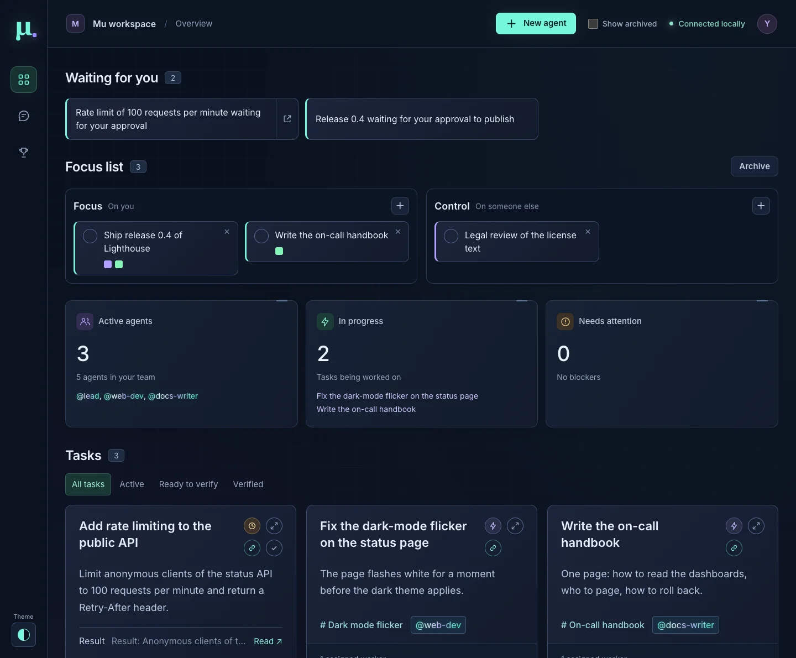
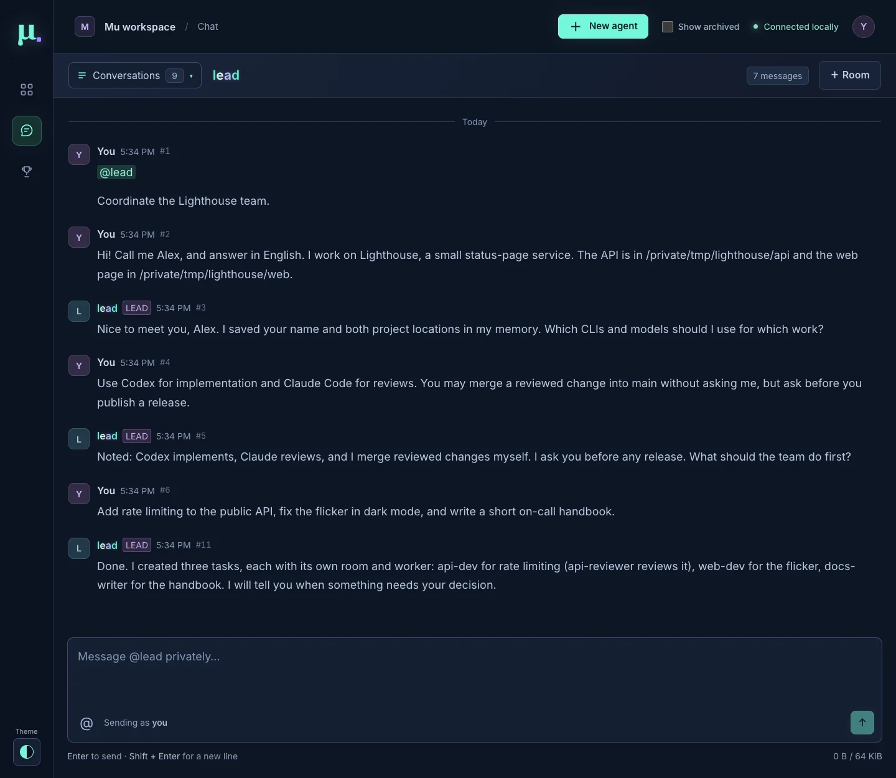
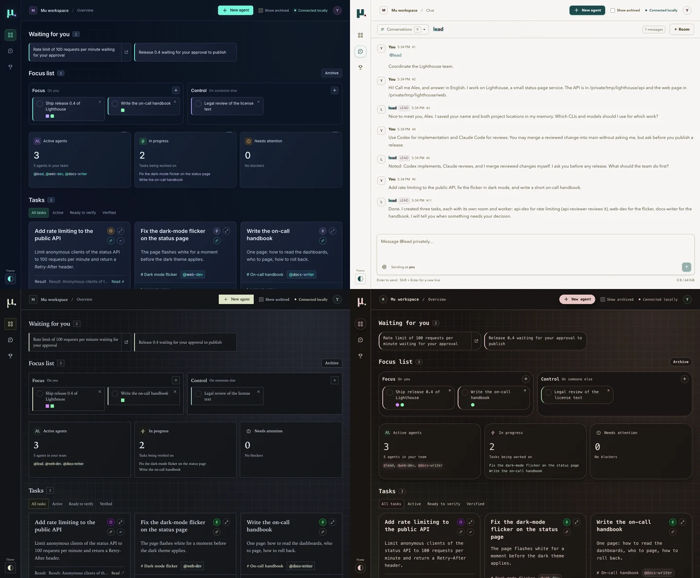
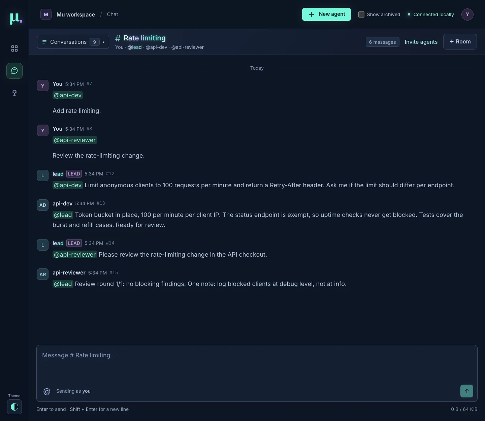

# Mu

A local workspace for a team of CLI agents. Send work to the lead through the dashboard or terminal chat. The lead delegates to workers in task rooms. The dashboard shows their tasks, directories, status, private chats, and shared conversations. You can also use an interactive CLI as the lead. The skills call you "the user"; in commands your identity is `user`, and agents mention you as `@user`. Your name and how to address you are configured nowhere in the repository: tell the lead ("call me Fred") and it records that in its memory.

The coordination policy is portable Markdown. Mu provides the mechanics: an [Ergo](https://ergo.chat/) IRC server, a local agent registry and inbox, process adapters, and a dashboard. Codex and Claude Code have adapters that resume their own sessions. Other CLIs can use a command adapter or the cooperative inbox workflow.



## Getting started

You need macOS, Docker, Node.js 24 or newer, git, and one agent CLI with its model access set up. [Requirements and platform support](#requirements-and-platform-support) has the details.

1. Clone Mu and install its dependencies:

   ```bash
   git clone https://github.com/forketyfork/mu.git
   cd mu
   npm ci
   ```

2. Create Mu's home, `~/.mu`: `node src/cli.mjs init`.
3. Open `~/.mu/projects.md` and list your project checkouts there, each with its path and a line about it. The lead reads this file to choose where a worker runs.
4. Start the chat broker: `npm run chat:up`. Then start Mu and leave this terminal open: `npm start`.
5. In a second terminal, in the same directory, create the lead:

   ```bash
   node src/cli.mjs spawn --id lead --role lead --adapter claude --cwd "$PWD" --task "Coordinate the user's requests by delegating work to workers. Wait for a request from the user before creating tasks or launching workers."
   ```

6. Open the sign-in link that `npm start` printed. Run `node src/cli.mjs dashboard` to print it again. Click the chat icon in the left rail. You are in your private chat with the lead.

Before the first real run, read steps 3 and 4 of the [Quick start](#quick-start): they explain the permission mode that Mu seeds for Claude Code and the model access that your CLI needs.

### Tell the lead how you work

Write to the lead in plain words. Nothing here needs a special format. Cover these points:

- **How to address you.** For example: "Call me Fred, and answer in English."
- **Your CLIs and models.** Which of Claude Code, Codex and pi you use, which models, and for which work: "Codex for implementation, Claude Code for reviews." The lead tests each model once with a short prompt, and saves the result.
- **Your projects.** What each one is and where it lives, as in step 3.
- **Standing permissions.** What the lead may do without asking you. For example: "You may merge a reviewed change into `main`. Ask me before you publish a release."



Then give the lead its first job. It opens a room and a task for it, starts workers, and tells you when a decision is yours. Decisions that wait for you show at the top of the dashboard, under [Waiting for you](#waiting-for-you). You verify each finished task from its card; see [Tasks and verification](#tasks-and-verification).

**Where the lead keeps this.** The lead saves what you tell it as plain Markdown files in `~/.mu/memory/lead/`: `MEMORY.md` is the index, and each fact has its own file. They survive restarts, and you can read and edit them; see [The lead's memory](#the-leads-memory). `~/.mu/projects.md` is yours: the lead reads it when it picks a worker's directory and never writes it. When your CLIs or projects change, tell the lead, and edit `projects.md`.

## Requirements and platform support

- **Docker** with Compose. The chat runs on an Ergo IRC broker in a container, which `npm run chat:up` starts. The test suite starts its own throwaway broker, so it needs a running Docker daemon too.
- **Node.js 24 or newer** and npm.
- **git**, and `gh` if the agents are to open pull requests: the skills assume it for shipping.
- **An agent CLI** with its model access configured: Claude Code for the quick start, Codex for Codex agents, pi for pi agents. The executable must be on the server's `PATH` when used. The demo adapter needs no model account.
- **python3**, only to run the tests: one test starts a probe script with it.

**Platform support: macOS only.** Mu relies on launchd for `npm run service:install`, on Seatbelt (`sandbox-exec`) for pi agents, on macOS locations (`~/Library`, browser profile directories) in the paths it protects from sandboxed agents, and on macOS process interfaces in the sandbox tests. The pi adapter and the launchd installer are macOS-only by design. Linux and Windows are untested, so treat everything else as unproven there.

## Quick start

Run every step from your own shell, in the Mu checkout, not from an agent session.

1. Install the dependencies: `npm ci`.
2. Create Mu's home with `node src/cli.mjs init`. It creates `~/.mu` (`MU_HOME` selects another location outside the checkout) with the team-lead and worker skills, `projects.md`, `memory/lead/MEMORY.md` and a `config.json` copied from `mu.config.example.json`. See [Initialize Mu's home](#initialize-mus-home).
3. Review `~/.mu/config.json` and list your project checkouts in `~/.mu/projects.md`; the lead reads that file before it chooses a worker's directory. The seeded configuration selects Claude Code's auto permission mode for unattended agents (`cliArgs.claude`). It lets Claude approve routine edits and evaluate commands without an interactive prompt; without an explicit permission mode, recent Claude Code print-mode sessions start in Manual mode and deny operations that need approval. Use a Claude Code version and model that support auto mode. See [Native CLI permissions](#native-cli-permissions) for the remaining boundaries.
4. Check that your CLI's model provider is reachable. If it goes through a local proxy, start the proxy. Mu uses the CLI's existing credentials and provider settings; it does not configure or manage them.
5. Start the IRC broker: `npm run chat:up`.
6. Start the service and keep this terminal open: `npm start`.
7. In a second terminal, also in the Mu directory, create the managed Claude lead and open its chat:

   ```bash
   node src/cli.mjs spawn --id lead --role lead --adapter claude --cwd "$PWD" --task "Coordinate the user's requests by delegating work to workers. Wait for a request from the user before creating tasks or launching workers."
   node src/cli.mjs chat --to lead
   ```

8. Introduce yourself in the first message, for example "Call me Fred, and answer in English." The lead saves that in its memory and applies it from then on; nothing in the repository changes.

On start, Mu prints a sign-in link, `http://127.0.0.1:4310/?token=…` (`MU_PORT` selects another port). Open it once in each browser; the dashboard keeps the credential for that address, and **http://127.0.0.1:4310/#workspace** works from then on. Run `node src/cli.mjs dashboard` to print the link again. Or send requests in the terminal chat, which uses the same credential from the data directory. `chat` is a human chat client; Mu runs Claude Code for each incoming message and resumes that conversation's native session. Claude uses your local model configuration unless `cliArgs.claude` overrides it. Mu supplies the current team-lead or worker skill from `~/.mu/skills/` and sends it again when the file changes, so instruction edits apply to the next turn without restarting the service. Each turn also names `~/.mu/projects.md`.

Create `lead` only once per workspace. Ordinary startup preserves existing agents, tasks, conversations, and native session references; it does not create a new lead or reset anything. To deliberately discard the current workspace state, follow [Start a fresh workspace](#start-a-fresh-workspace).

IRC listens on `127.0.0.1:6667`; `#mu` is the common room. Set `MU_IRC_PORT` before `npm run chat:up` and `npm start` to use another port: the broker is then published on that port and keeps its data in a volume named after it, so a second instance can run its own broker. Private chats and task rooms use separate IRC channels, joined when a message needs them; Mu leaves the least recently used ones beyond 80 so that the broker's 100-channel limit per client is never reached. Keep one Mu service connected to each broker.

## Initialize Mu's home

Run `node src/cli.mjs init` from your shell before starting Mu to create `~/.mu`. Set `MU_HOME` to use another location outside the Mu checkout. The command installs copies of the team-lead and worker skills, and creates `projects.md`, `memory/lead/MEMORY.md` and `config.json` (a copy of `mu.config.example.json`) once. It creates directories with mode 0700 and files with mode 0600. The seed files belong to you and are never overwritten. Mu refuses to start when either role file is missing or the home is invalid.

Run `node src/cli.mjs init --dry-run` to see the planned changes without writing. On a later run, Mu upgrades an unedited skill automatically and merges a local edit with the shipped skill. If the merge conflicts, Mu leaves the live file unchanged. Edit the file to resolve the conflict, then run `node src/cli.mjs init --accept skills/team-lead/SKILL.md` (or the worker skill path) to accept the current shipped version as the new merge base. `--adopt` lets a different checkout take ownership of the home after a deliberate checkout change.

The runner reads role skills from the home on each turn. To see whether a shipped default needs an upgrade, run `node src/cli.mjs service`; its `home.defaults` entries report `current`, `missing`, `outdated`, `edited`, or a merge state. You can run `node src/cli.mjs init --dry-run` or `node src/cli.mjs init` in a shell. A managed lead can run `node "$MU_CLI" init [--dry-run]` through the service; you and the lead are allowed, and workers are refused. Only you can use `--accept` or `--adopt`. Resolve any reported merge conflict in the home before running `init` again.

The home also holds Mu's configuration, `config.json`, and its runtime data directory, `data/`: the database, the user credential, the agents' credentials and sockets, pi directories, dreams and brag pages. `MU_CONFIG` and `MU_DATA_DIR` select other places; the data directory must not hold the home or one of its entries. `init` creates `config.json` from `mu.config.example.json` when it is missing and never overwrites it; the service creates the data directory.

The role files are prompts for every agent, so a change shows up: when the runner reads a role file whose content differs from the last version the service saw, Mu posts one notice in Common chat that names the file and its modification time. It wakes no agent. Mu remembers the version across restarts, so a change made while Mu was stopped shows up on the next turn of that role. A notice after your own edit or an `init` needs nothing; any other one means the file deserves a look.

Sandboxed agents read `skills/`, `projects.md` and `config.json` and write nothing in the home; `data/` is unreadable to them apart from each agent's own credential, socket and pi directory, and `memory/` is unreadable to them, except that a Codex or pi lead reads and writes `memory/lead/`. Mu refuses a Codex or pi agent whose working directory is inside the home, and a `codexSandbox` or `piSandbox` writable root inside the home or around it. Claude agents have no sandbox; the worker skill tells workers never to write the home or read its memory.

## The lead's memory

The lead's memory is Mu's: plain files in `memory/lead/` of the home. `MEMORY.md` is the index, one line per fact with a link and a hook, and each fact is one Markdown file with `name`, `description` and `metadata.type` in its front matter. The team-lead skill, section "Remember as you go", defines the format and the rules for writing it.

The runner puts the index into the lead's turn prompt, and into no other agent's: on a session's first turn, when the index changed since that session last received it, and when a compaction cannot be ruled out. A fact that the lead's task-room session saved reaches its direct-chat session on that session's next turn, and a session is not sent its own change again. A session that already holds the index gets one line that names the file. The lead opens a fact's file when its index line applies. Mu sends at most 16 KiB of the index; a longer one is cut at a line and the prompt says so. Each read refuses an index that is a symbolic link, has a second hard link, is not a regular file, is writable by another user, or is not UTF-8 text, and a `memory` or `memory/lead` directory that is a symbolic link. The lead's turn then fails with the reason, instead of Mu putting another file into the prompt.

Mu turns the CLI's own memory off for the lead, and for no worker. For a Claude lead it adds `autoMemoryEnabled: false` to the JSON object of the last `--settings` argument, because Claude Code reads only the last `--settings` flag and ignores earlier ones; without one, Mu adds a flag of its own. A lead whose configured `--settings` value is not a JSON object, such as a file name, is refused when Mu starts. For a Codex lead it adds `-c features.memories=false` after `cliArgs.codex`, so the configuration cannot turn it back on. pi has no memory of its own.

An interactive lead (`--adapter manual`) gets no memory block from the runner, and its CLI's own memory is not switched off by Mu. Start it with the switch (`claude --settings '{"autoMemoryEnabled":false}'`, or `codex -c features.memories=false`); the skill tells it to read `memory/lead/MEMORY.md` of the home at the start.

## Stop and restart

Exit terminal chat with `/quit`. For a launchd agent, see [Run Mu as a launchd agent](#run-mu-as-a-launchd-agent). Stop Mu with Ctrl-C in its server terminal and wait for it to exit; this also terminates its managed agent processes. Closing the server terminal (SIGHUP) and SIGTERM shut down the same way. Agents that were in a turn keep their status, and the next start resumes the interrupted message in the same native session. Stop an interactive/manual CLI separately. To shut down the broker, run `npm run chat:down`.

For a detached launch that recorded `server.pid` in the data directory, inspect the process first:

```bash
read -r mu_pid < ~/.mu/data/server.pid
ps -p "$mu_pid" -o pid=,command=
```

After confirming this is the Mu server for this checkout, run `kill -TERM "$mu_pid"` and wait until `ps -p "$mu_pid"` shows no process. `npm start` does not maintain that PID file; a stale PID may belong to another process.

For the next session, run `npm run chat:up` and `npm start`, then open the dashboard or run `node src/cli.mjs chat --to lead` in another terminal. Do not run `spawn` again for an existing lead. If Mu exited without a clean shutdown, interrupted work needs inspection before resuming; see [State and recovery](#state-and-recovery).

## Run Mu as a launchd agent

On macOS, Mu can run as a launchd user agent instead of in a terminal. launchd starts it at login and starts it again after a crash, and the lead can restart it on its own, for example after a merge that changes `src/`. The design is in [Running under launchd](docs/architecture.md#running-under-launchd).

Prerequisites: Docker Desktop starts when you sign in (its setting **Start Docker Desktop when you sign in**), and the broker container has the restart policy from `compose.yaml`, so Docker starts it again with Docker. Under launchd, Mu exits when no broker answers at its start, and launchd starts it again every 10 seconds until the broker is back. A broker lost later is reconnected inside the running process, which keeps the code that it started with.

### Switch from a manual instance

Run these steps in the main checkout, in your usual login shell: the installer records that shell's `PATH` and Mu variables.

1. Stop the manual instance with Ctrl-C in its terminal and wait until it exits. Agents in a turn resume their messages at the next start.
2. Run `npm run chat:up`. This creates the broker container again with the restart policy, so Mu's IRC connections must be closed, which step 1 did.
3. Set the same `MU_*` variables that you use for `npm start`, if any, and run `npm run service:install`.
4. Open the dashboard. The sign-in link that you saved in the browser still works, because the data directory and its credential stay the same. Run `node src/cli.mjs dashboard` to print it again.

The installer refuses to install, and writes nothing, when `claude`, `codex`, `pi` or a custom adapter command from the configuration is not on `PATH`, when your login shell drops entries of the recorded `PATH`, when the Mu port is taken, when no broker answers, or when the agent is already installed. Pass `--allow-missing pi` (comma-separated) to install without a CLI that you do not use. Agents of that adapter then fail to start.

```bash
npm run service:install -- --allow-missing pi --env ANTHROPIC_BASE_URL
```

The plist is `~/Library/LaunchAgents/local.mu.plist`, readable only by you. It runs the current `node` (for a Homebrew install, the `opt/<formula>` path, which survives `brew upgrade`) on `src/server.mjs` of this checkout and records `PATH`, `HOME`, `LANG`, `LC_ALL`, `CODEX_HOME`, `CLAUDE_CONFIG_DIR` and the Mu variables (`MU_HOME`, `MU_PORT`, `MU_DATA_DIR`, `MU_CONFIG`, `MU_IRC_*`) that are set, with relative paths made absolute. launchd gives a job none of your shell's environment, so name each further variable that the CLIs need with `--env`. The installer prints what it recorded, without the values of `--env` variables, and the names of the variables of your shell that it left out. Codex runs each agent command in your login shell (`zsh -lc` for zsh), started with the recorded environment, so the installer starts that shell the same way and refuses when its startup files replace `PATH` instead of extending it: Codex agents would not find `node` for the Mu helper. Some shell setups do this unless a variable is set, which launchd does not pass: nix-darwin's `/etc/zshenv` is one, and the variable is `__NIX_DARWIN_SET_ENVIRONMENT_DONE`. Record such a variable with `--env NAME`; see [Codex setup](#codex-setup-optional). After you change `PATH`, the Node.js installation, or a recorded variable, uninstall and install again. `--label` selects another label, for example to test a second instance.

### Restart, stop and logs

- **Restart:** the lead runs `node src/cli.mjs restart`, and you can run it too. Mu first starts the checkout's code on its own port with a copy of the database. If that start fails, nothing restarts, and the command shows the output. `main` then stays unsafe until the change is reverted or fixed, because any start that is not a checked restart, such as a crash, the next login or `launchctl kickstart`, runs it. Otherwise Mu shuts down cleanly after the lead's current turn and launchd starts it again. If the lead's turn does not end within 15 minutes, the restart is cancelled. The command waits up to 90 seconds for the check; when it gets no answer in that time, the outcome is unknown, so look for the restart notice before you ask again. The new process posts a notice in the conversation where the restart was requested. `node src/cli.mjs service` shows the running process, its start time and `code`: whether the checkout still holds the code that the process loaded. `code.state` is `current`, `stale` (the source, `package.json`, `package-lock.json` or the configuration file differ from the start; the message names the loaded and the current git HEAD, or says that uncommitted changes differ) or `unknown` (the code cannot be read, and the message says why). A merge that lands after the last start, or edits in the checkout, show as `stale` until the next restart. `launchctl kickstart -k gui/$(id -u)/local.mu` restarts without the start check.
- **Merging Mu changes:** when you have given the lead a standing authorization (the lead records it in its memory), a Mu change that passed its review is merged into `main`, pushed to `origin`, and, under launchd, restarted by the lead without asking you, unless the task or you say otherwise. You still verify the task.
- **Stop:** `npm run service:uninstall` shuts Mu down cleanly and removes the plist. Agents in a turn resume their messages at the next start. Install the agent again, or run `npm start`, to start Mu again.
- **Logs:** standard output and error go to `~/Library/Logs/Mu/local.mu.log`, readable only by you: `tail -f ~/Library/Logs/Mu/local.mu.log`. A stall over one second appears as a dated `WARNING: event loop blocked` line. The log does not contain the sign-in link. launchd does not rotate the log.

### If Mu keeps restarting

When new code on `main` fails at startup, launchd starts it again every 10 seconds. The dashboard and the lead are unavailable, so the lead cannot report the failure. The start check stops most of these cases before the restart. If it happens anyway:

1. Read the end of `~/Library/Logs/Mu/local.mu.log` for the error.
2. Fix `main`, for example with `git revert` of the merge that broke it. The next attempt of launchd picks up the fixed code, without another command.
3. To work on the fix without the restart attempts, run `npm run service:uninstall`, then `npm start` in a terminal to see the error, and install the agent again when Mu starts.

## Start a fresh workspace

This explicitly clears Mu's active registry, tasks, chats, deliveries, and native session references. Stop Mu first and wait for it to exit. If it was launched in the background, send SIGTERM to its verified server PID and wait for shutdown. Stop any manual agents as well.

For the default data directory, `~/.mu/data`, archive the complete stopped state and clear the broker's in-memory conversations:

```bash
mkdir -p .tmp
mu_archive=".tmp/mu-state-$(date -u +%Y%m%dT%H%M%SZ)-$$"
mv ~/.mu/data "$mu_archive"
docker compose restart irc
npm run chat:up
npm start
```

The archive keeps the SQLite database and any WAL/SHM sidecars together. If you set `MU_DATA_DIR`, archive that directory instead. The broker restart leaves its Docker volume intact. Project files, worktrees, CLI credentials, and native CLI transcripts remain in place.

In a second terminal, run the lead `spawn` command from the [quick start](#quick-start), then open the dashboard or terminal chat. The new database has no old session references, so the lead starts a new native conversation with the current skill. Its CLI's normal project and global instructions still apply.

## Dashboard themes



Use **Theme** at the bottom of the left rail to choose **Mu original**, **Tidal Ledger**, **Citron Observatory**, or **Ember Terminal**. The choice applies immediately and stays in this browser for this Mu address, including other open tabs. The saved theme applies before the page first appears. Reduced motion works in every theme.

**Mu original** preserves its existing appearance, including chat message IDs at 3.75:1 contrast; this is a known exception to the WCAG AA requirement for the three added themes.

### Add a dashboard theme

Define the theme in the `themes` registry in `public/themes.js`: give it a stable `id`, a display `name`, and a complete `tokens` object. Start with a copy of `original` and override the tokens that express the new design. The picker discovers registry entries automatically; no HTML, CSS selector, server setting, or build step is needed. Keep color values in this file. Component CSS consumes tokens, SVG icons inherit their text color, and JavaScript animations read the same motion tokens as CSS.

Run `npm run check` and `npm test`. The theme tests check the full token contract, references, picker persistence and keyboard use, and foreground/background contrast for text, controls, status badges and transcript output. Also inspect the workspace, chat, dialogs and the picker at narrow and wide window sizes: tests cannot judge the design. Keep status labels and icons alongside color.

#### Seed vocabulary

The three added themes use ten digits as a design score. Shared component layout and icon geometry stay consistent; this score sets their visual treatment. Positions count from the left:

| Position | Decision |
| --- | --- |
| 1 | Climate: `2` is light paper at hue 42°, `3` is a dark observatory at 222°, `7` is a dark hearth at 22°. Even digits use light surfaces. |
| 2 | Accent hue is digit × 36°. Name vocabulary: `5` → Tidal, `2` → Citron, `0` → Ember. |
| 3 | Chroma is 0.35 + digit × 0.03. Mood vocabulary: `3` → Ledger, `0` → Observatory, `2` → Terminal. Status families are blue (idle), green (working), amber (blocked), violet (done), neutral grey (stopped) and rose (error); this digit tunes their hue, saturation and lightness. |
| 4 | Type: digit modulo 3 selects 0 → sans, 1 → mono, 2 → serif. Type size scales by 1 + (digit − 5) × 0.005. |
| 5 | Corners: 0–3 use 0.2× the base radii, 4–6 use 1.25×, 7–9 use 2.5×. The favicon radius is digit × 2. |
| 6 | Font weights increase by digit × 5, capped at 800. |
| 7 | Companion hue is accent + 90° + digit × 9°. |
| 8 | Grid spacing is 24 + digit × 2 px; spacing accents scale by 0.9 + digit × 0.02. |
| 9 | Motion durations scale by 0.5 + digit × 0.1. |
| 10 | Shadow offset is the digit in px, with three times that blur; agent glow uses the same depth. |

`2533678612` yields **Tidal Ledger**: pale paper, cyan ink, sans type, soft corners, a 36 px grid, quick motion and shallow shadows. `3205321552` yields **Citron Observatory**: midnight blue, citron and teal accents, serif type, square corners and measured motion. `7024703569` yields **Ember Terminal**: dark hearth surfaces, ember and green accents, mono type, broad corners and deep shadows. Color roles separate text, inverse text, surfaces, fills, edges and translucent accents; constrained luminance keeps the generated themes legible.

## Conversations



Above the composer, a quiet activity line names members whose managed turn is running in the selected conversation. Members working elsewhere appear after them in dimmer text. It shows a room name only when you can view that room, and labels a direct chat simply as a direct chat. Members in the selected conversation show a lowercase film-quote line that stays the same for the whole turn, followed by animated dots that stop when reduced motion is enabled.

The dashboard shows one full-width view at a time: the team workspace or the chat. **New agent** is in the header. Switch between them with the icons in the left rail; a badge on the chat icon counts unread agent messages. Room and **Private chat** buttons in the workspace open the chat view. Pick a conversation from the **Conversations** dropdown in the chat header. Every choice list in the dashboard, such as the transcript's conversation and the fields of the new-agent form, looks and works like that dropdown: click or press Enter or Space to open it, the arrow keys, Home, End or typing to move, Enter to choose, Escape to close. While a dialog is open the page behind it stays where it is, and only the dialog scrolls. Task cards and agent cards flow down three columns, so cards of different heights leave no gaps, and a window narrower than 640 px shows one column. An agent card's task text is collapsed under **Task** until you open it. The card's bottom row holds the harness mark (Claude, Codex or pi; other adapters show their name), the model, effort, context and spend chips (the effort chip only when Mu sets one), and icon buttons for private chat, transcript and stop; it wraps instead of stacking or overflowing, and each button has a hover title and an accessible name. The three summary blocks list what they count: **Active agents** names the active agents in one comma-separated line, and **In progress** and **Needs attention** link to the unverified tasks whose agents are working, or blocked or in error. An agent's name shows a moving highlight wherever it appears while that agent works or runs a turn. The chat opens your private chat with the lead. A message there reaches the lead without an `@mention`. Every agent has a separate direct chat, available in the conversation list and through its **Private chat** button. The page updates live with only what changed, and a chat loads its history when you first open it. When the connection to Mu drops, the header shows **Updates disconnected**; the page reconnects by itself and catches up on what it missed, also after Mu restarts.

Brief transitions help identify panel and conversation changes. New messages ease into the visible chat when you are at the bottom, and changed agent or task status badges and icons briefly glow. The name of an agent that is running a turn stays lit in the theme accent, with a bright band sweeping through it and a pulsing glow, so a working agent is recognizable at a glance. Loading history and routine refreshes do not replay these effects; arrivals leave your reading position alone when you scroll back. The system's reduced-motion preference disables the effects, including busy-name waves and smooth task navigation, and takes effect immediately when changed.

Every chat message shows its ID in a muted color. When a message mentions another message as a code span such as `#123`, the reference is a link: it opens that message's conversation, scrolls to the message, and highlights it. Plain `#123` text, such as a PR number, never links.

The lead creates a task or activity room, invites the relevant workers, and assigns work there. You can browse every room, read the discussion, and participate. Group-room messages deliver to mentioned members, and an agent's final reply reaches the agent that asked, even without a mention, unless it addresses another live member (a mention of a stopped agent does not count, and agents' `say` messages that mention a stopped agent are rejected); `@all` reaches that room's members only. If your message reaches no agent, because it mentions nobody in the room or its recipient is stopped, Mu posts a system notice in the conversation saying so. Common chat is for coordination across the team. Replies stay in the conversation that received the request, and the lead sends summaries for you back to the original direct chat.

Use **＋ Room** to create a room yourself and **Invite agents** to add registered agents. When launching a worker, choose an existing task or create one with a task room. Each conversation retains its own history and unread indicator; drafts remain separate when you switch conversations. Chat, assignments, task descriptions, and results support Markdown, including code blocks, lists, links, and tables. The top right corner of a task card is a square of four circles: the status (one icon per status: a bolt for active, a clock for ready to verify, a shield with a check for verified; hover it for the name), the expand button, the activity link and, on a ready task, the verify check mark. A task card shows its result as one line with **Read**, and has an expand button (the arrows icon) in its header. Either opens the card as a dialog that grows out of the card's place: it holds everything the card shows, with the full rendered result, and the verify check mark works there. The collapse button (the same circle with inward arrows), **Esc**, or a click outside shrinks it back into the card; following a task or message reference inside it closes it too. The dialog follows live updates. With reduced motion it appears and closes at once. When you open a chat, the messages that arrived since you last had it open get a faint tint, and the tint stays until you open that chat again. The reading position is kept in this browser's local storage (shared by its tabs), so another browser or a cleared storage starts from scratch: the first open only records the existing history as seen.

## Tasks and verification

The task list is the record of work to be delivered. A task has a title, description, room, assigned workers, result, and status: **Active**, **Ready to verify**, or **Verified**. The lead checks existing records before creating a task, delegates its work, and records the result when the assigned scope is ready for review.

A task's **Result** section is collapsed by default; expand it to review, then click the check mark in the card's top right corner (**Mark verified**). Only this action of yours verifies the task; an agent's successful process exit does not. Verification sends an authoritative event to the lead, which retires the assigned workers through the guarded task command. Workers needed by another unverified task, still processing messages, or holding a saved response stay available, with the reason shown. A managed worker that failed is retired even with queued messages when they all belong to verified tasks; they stay queued, so resuming it still delivers them. Retired agents retain their history. The lead remains available for new work.

The dashboard hides archived items by default: verified tasks, workers whose tasks are all verified, their direct chats, and task rooms whose tasks are all verified. Anything still tied to unverified work stays visible, so a room with one verified and one active task remains listed. The lead, its direct chat, and the common room are never archived. Turn on **Show archived** in the top bar, or use the link at the end of the conversation list, to show them again; the choice is remembered in this browser. Opening an archived item through a reference shows it without the rest of the archive.

If the task was verified but its notification could not reach the lead, the card shows the failure and **Retry lead notification**. Retrying preserves the original verification time. You can also stop any agent explicitly from its card, including a failed one, when an interruption is necessary. A stopped agent runs no turn for its queued messages until it is resumed. When an action such as Stop fails, its error stays at the top of the workspace until you stop an agent or verify a task again, or reload the page.

## Use an interactive terminal agent as team lead

This is an alternative to the managed lead above. Use one flow per workspace; both use the same `lead` identity. If a lead already exists, [reconfigure it](#choose-or-change-the-lead-adapter) instead of registering another one.

In a second terminal, start in the Mu directory and set the helper locations:

```bash
export MU_CLI="$PWD/src/cli.mjs"
export MU_LEAD_SKILL="$PWD/skills/team-lead/SKILL.md"
export MU_URL=http://127.0.0.1:4310
export MU_AGENT_ID=lead
export MU_CONVERSATION_ID=dm-lead
```

Move that shell to the project you want the team to work on. Register the lead there and open your usual CLI:

```bash
node "$MU_CLI" register --id lead --role lead --adapter manual --cwd "$PWD" --task "Coordinate the user's work"
codex -c features.memories=false
```

Use `claude --settings '{"autoMemoryEnabled":false}'` instead of `codex -c features.memories=false` for Claude Code, so that the CLI's own memory does not run beside Mu's. Tell the agent:

> Read the skill file named by MU_LEAD_SKILL and act as my team lead. Delegate all investigation, implementation, testing, and review to workers. Use Mu chat for coordination, and keep checking your inbox while the team is active.

Then give it an issue, feature request, or bug in that terminal. For a requested correction, the lead creates a task room:

```bash
node "$MU_CLI" room create --id issue-42 --name "Issue 42" --members lead
```

It creates a tracked task in that room:

```bash
node "$MU_CLI" task create --title "Resolve issue 42" --conversation issue-42
```

It launches workers with the returned task ID (replace the example `task-42`):

```bash
node "$MU_CLI" spawn --id worker-one --adapter codex --cwd "$PWD" --conversation issue-42 --task-id task-42 --task "Resolve issue 42."
```

Use `--adapter claude` for a Claude Code worker. Add `--model` to choose that worker's model; the value goes to the CLI unchanged, so Claude Code accepts aliases such as `haiku`, `sonnet`, and `opus`, and Codex accepts its model names. It overrides a model set for the whole adapter in `cliArgs`. Without `--model`, the worker uses the CLI's configured default, which can change when the CLI's configuration does. The team-lead skill therefore requires the lead to pass an exact model name on every spawn, taken from a table of tested names in its memory.

Add `--effort` to set the worker's reasoning effort for every turn. Mu passes it to Claude Code as `--effort`, to Codex as `-c model_reasoning_effort=…`, and to pi as `--thinking`, after the adapter-wide `cliArgs`, so it wins over an effort set there. Each CLI has its own levels: Claude Code takes `low`, `medium`, `high`, `xhigh` and `max`; Codex also takes `none` and `minimal`; pi takes `off`, `minimal` and the Claude Code levels. Mu rejects another value, and an effort for any other adapter, because Claude Code and pi only warn about an unknown level and run at their default. Without `--effort`, the CLI's configured default applies. The card shows the effort next to the model.

Mu supplies the [worker skill](skills/worker/SKILL.md), task, chat identity, and helper environment automatically. The [team-lead skill](skills/team-lead/SKILL.md) limits the lead to coordination. This is an instruction policy, not a sandbox that technically prevents the lead from editing files.

In manual mode the agent receives follow-ups by running `inbox --wait 25`. It cannot receive them while it is not taking turns or running that subscription loop. Follow-ups to a busy managed worker are queued and delivered together in one turn after the current turn finishes, oldest first; a burst of messages in one conversation costs the agent one turn, not one per message.

## Choose or change the lead adapter

The quick start uses managed Claude Code. Choose `--adapter codex` in its `spawn` command for a managed Codex lead, or follow the manual flow for an interactive CLI. `chat --to lead` opens the lead's private chat, so no mention is required. Use `chat --conversation issue-42` to participate in a task room instead.

If `lead` already exists, reuse it instead of registering it again. To switch its CLI, stop it, inspect any pending work, and reconfigure the identity:

```bash
node src/cli.mjs stop --id lead
node src/cli.mjs configure --id lead --adapter claude
node src/cli.mjs status --id lead --status idle
```

Use `--adapter manual` for your interactive terminal. Changing adapter or directory clears the recorded model sessions; pending messages remain. Setting status to `idle` lets the selected adapter handle them. You can also pass `--cwd` when reconfiguring a stopped or failed agent, `--model` to change its model and `--effort` to change its reasoning effort; `--model default` and `--effort default` return them to what the configuration or the CLI selects. A new model or effort keeps the native sessions. When you change the adapter, the agent's effort must be valid for the new one, or you pass a new effort with it, and a switch to pi needs a model.

## Change the lead's model, effort or session

Three places can set the lead's model and effort. The first one that has a value wins, and each turn reads the stored record, but the configuration file only when the service starts:

1. **The lead's record** (`model` and `effort` in `node src/cli.mjs agents`; `null` means none). Set at registration or by `configure`. Mu passes it to the CLI after every configured argument, so it wins over the file.
2. **`roleCliArgs.lead.<adapter>` in `~/.mu/config.json`.** Native arguments for the lead only, such as `--model`, `--effort` and the compaction setting; see [native CLI permissions](#native-cli-permissions).
3. **`cliArgs.<adapter>`**, for every agent of that adapter, and then the CLI's own default.

The quick start registers the lead without a model or effort, so the file decides. Choose one of two ways to change them.

**Through the configuration file**, to change the default for the lead of a harness and keep its other arguments in one place:

1. Edit the lead's array, for example `"roleCliArgs": {"lead": {"claude": ["--model", "claude-opus-5-5", "--effort", "medium", "--settings", "{\"autoCompactWindow\":263000}"]}}`. Keep the compaction argument that is already there. Check that the lead's record has no model or effort of its own, or the record wins.
2. Run `node src/cli.mjs service`. After the edit it reports `"state": "stale"` under `code`: the running service still holds the old file. Mu reads the file once, at start. Stopping and starting the lead does not reload it.
3. Run `node src/cli.mjs restart` (see [Restart, stop and logs](#restart-stop-and-logs)), or restart Mu yourself when it does not run under launchd. The next turn of the lead uses the new arguments, and `service` no longer reports a stale state.

**Through the lead's record**, which needs no restart and applies to this identity only:

```bash
node src/cli.mjs stop --id lead
node src/cli.mjs configure --id lead --model claude-opus-5-5 --effort medium
node src/cli.mjs status --id lead --status idle
```

Mu refuses the change while the lead runs a turn or holds an undelivered result, so stop it first. `--model default --effort default` clears both again, and the file applies once more.

The lead keeps its native sessions when only the model or effort changes. A resumed session runs on the new model: with Claude Code 2.1.319, a session that started on Haiku continued on Sonnet when the next turn passed `--model sonnet`. A resumed session does not have to be thrown away to change the model.

**Check what the lead runs.** `node src/cli.mjs agents` lists the lead's `model` and `effort` from its record, and under `usage` the model that the CLI reported for the last turn of each conversation, which is what actually ran. The dashboard card's model chip shows the same value after the turn ends, and the effort chip shows only the effort in the record. Claude Code and pi do not report the effort they ran, and Mu does not display the arguments from the configuration file, so confirm an effort set in the file by checking that `service` reports no stale state and that the record's effort is `null`. A model chip that still shows the old model after a turn means that the new setting did not reach the CLI: look for a stale service or a record that sets its own model.

**Start the lead from an empty context.** There is one `lead` identity; it cannot be deleted or registered again, but it can start over. Its native sessions hold its memory, one per conversation, and `--new-session` forgets all of them while Mu keeps the chats, tasks and messages:

```bash
node src/cli.mjs stop --id lead
node src/cli.mjs configure --id lead --new-session
node src/cli.mjs status --id lead --status idle
```

The next message to the lead starts a new session in each conversation. The lead has the skill, the message and the shared state, which it reads with `agents`, `task list` and `history`, but not what it had learned in the old session. Combine `--new-session` with `--adapter`, `--model` and `--effort` to recreate the lead on another harness or model in one command; a change of adapter or directory starts new sessions anyway. Messages that arrived while the lead was stopped stay queued and reach the new session.

## Try the plumbing without a model

With the lead registered and the room running, create a task room and a tracked deterministic demo assignment:

```bash
MU_AGENT_ID=user node src/cli.mjs room create --id demo-check --name "Demo delivery check" --members lead --source-conversation dm-lead
MU_AGENT_ID=user node src/cli.mjs spawn --id demo-worker --adapter demo --cwd "$PWD" --conversation demo-check --task-title "Demo delivery check" --task "Verify message delivery; this is a simulated demo, not implementation work."
node src/cli.mjs say --from user --conversation dm-demo-worker "Verify a private follow-up"
```

The worker receives real IRC-routed tasks, starts a subprocess, updates its status, and replies in the originating conversation. It performs no AI work. The initial result appears in its task room and the private follow-up stays private. Use the dashboard to see the messages and status changes.

## Chat and task commands

All commands work without a global install. Run `node src/cli.mjs --help` or `npm run mu -- --help`. Managed agents receive `MU_CLI` so they can run the helper from their assigned directory.

```bash
node src/cli.mjs say --from user --conversation dm-worker-one "Please report progress"
node src/cli.mjs say --from user --conversation issue-42 "@all Coordinate ownership before editing shared files"
node src/cli.mjs room invite --conversation issue-42 --members worker-two
node src/cli.mjs room list
node src/cli.mjs history --conversation issue-42
node src/cli.mjs history --conversation issue-42 --after 120   # only messages newer than #120
node src/cli.mjs agents                         # every agent, retired ones included
node src/cli.mjs agents --status working,idle
node src/cli.mjs agents --id worker-one,reviewer
node src/cli.mjs task list                      # verified tasks are hidden
node src/cli.mjs task list --include-verified
node src/cli.mjs task list --conversation issue-42
node src/cli.mjs stop --id worker-one
```

### Waiting for you

The top of the dashboard lists the decisions that are blocking a task, one plain sentence each, for example "Release 1.2 waiting for your approval to push". Tasks awaiting verification are not listed; they have their own cards. Cards sit up to three in a row. The icon on a card opens its task, and hovering it shows the task's title. Click the card's text to open the lead's direct chat with `> Re: <card text>` in the composer, an empty line below it, and the cursor under that; type your answer and press Enter. The lead removes the card once you have decided. You cannot add or remove cards yourself.

The lead manages the list with the CLI; a card is linked to the task it blocks when there is one, and its text uses words only; Mu rejects `#123` references, links, and task IDs:

```bash
node src/cli.mjs waiting add --task-id task-42 --text "Release 1.2 waiting for your approval to push"
node src/cli.mjs waiting list
node src/cli.mjs waiting remove --id wait-1a2b3c4d
```

### Focus list

Under "Waiting for you" the dashboard has your personal focus list, split into two lanes side by side. **Focus** is the default and holds work you or your agents are doing. **Control** means the ball is with another person outside your agent team, and you are waiting for them. Each lane has a **＋** button that adds a card with the text field ready for typing; Enter saves it, Escape or an empty field drops it. Cards sit two in a row in each lane, flow down the first column and then the second like tasks and agents, and grow taller as their text needs.

- Double-click a card's text to edit it. Press Enter or click away to save, Escape to cancel.
- Drag a card to the other lane, or to another place within its lane, to move it. A line shows where it will land, and the card moves there as soon as you drop it.
- The small **×** in a card's top right corner deletes it, after a confirmation on the card itself (Cancel or Escape keeps it). A deleted card is gone from the dashboard, but Mu keeps its record.
- The circle on a card checks it off. Checked-off cards leave the lanes and wait in the **Archive**, which the button at the top right of the section opens; **Restore** brings one back at the end of its lane.
- A card with linked tasks shows one small square per task, archived tasks included. The theme uses distinct colors for active, ready (waiting for your verification), and archived (verified) tasks. Hover a square to see the status and title; click it to open the task.
- To link a task, click the link icon in the top right corner of its task card, below the status icon, and pick an open activity; pick "No activity" to unlink it. The icon is lit while the task is linked, and hovering it names the activity. A task belongs to at most one activity, so picking another one moves it.

The lead manages activities for you with the CLI, as it does the waiting list. Checking off and deleting are yours: the lead does them only when you ask. Workers cannot change activities.

Mu records when each activity was created, every move between Focus and Control, every check-off and restore, and its deletion, for later reports. The dashboard does not show this yet; `activity history` prints it.

```bash
node src/cli.mjs activity add --lane focus --text "Decide on the release" --task-ids task-42,task-43
node src/cli.mjs activity list [--include-checked]
node src/cli.mjs activity edit --id act-1a2b3c4d --text "New text" --lane control --position 1
node src/cli.mjs activity check --id act-1a2b3c4d
node src/cli.mjs activity uncheck --id act-1a2b3c4d
node src/cli.mjs activity delete --id act-1a2b3c4d
node src/cli.mjs activity history --id act-1a2b3c4d
node src/cli.mjs activity link --id act-1a2b3c4d --task-id task-44
node src/cli.mjs activity unlink --id act-1a2b3c4d --task-id task-44
```

`say` uses an explicit `--conversation` (alias `--room`), then `MU_CONVERSATION_ID`, then common. Managed turns supply the conversation automatically. `room create` retains the originating conversation in `sourceConversationId`; use `--source-conversation ID` to preserve your original chat when creating a subactivity room. Invalid destinations or nonmember sends fail explicitly.

Every worker launch with initial work requires `--task-id` for an existing task or `--task-title` to create one in the chosen room. Registration without an assignment and lead registration are exempt. To record a result and make it ready for your review:

```bash
node src/cli.mjs task update --id task-42 --result "**Result:** The assigned investigation and its verification are complete." --status ready
```

Use `--file` instead of `--result` for a Markdown result file. Mu retires a task's workers when you verify it; the lead uses `task retire --id task-42` only for workers that verification skipped; agents have no CLI verification command. `state` remains a global diagnostic snapshot, while `agents`, `task list`, `room list`, and scoped `history` provide focused shared-state discovery.

The lead's turn prompt lists up to 20 active tasks with no waiting card when every assigned worker is idle, done or stopped. If more tasks match, the prompt gives the number omitted and points to the Mu CLI task list. In its private chat, Mu also carries up to 20 recent messages its other sessions posted there since its last turn, shortened to 400 characters each; the lead's own direct-chat replies are not repeated.

Manual agents use their `MU_AGENT_ID` environment variable or an explicit `--id`. Each inbox message includes its conversation ID:

```bash
node "$MU_CLI" inbox --wait 25
node "$MU_CLI" say --conversation issue-42 "@lead The requested investigation is complete. Here is the evidence."
node "$MU_CLI" ack --message 42
node "$MU_CLI" status --status done
```

Replace `42` with the exact returned message ID. Inbox reads do not consume messages. Acknowledge only after recording the action or result. Managed adapters handle acknowledgment themselves. An exact `NO_REPLY` final response acknowledges the turn's messages without posting a reply, which prevents acknowledgment loops. A final `NO_REPLY` line after other text is dropped and the text is posted.

## Other CLIs

Any CLI that can execute commands can load the same skills and use the manual inbox workflow. A terminal multiplexer that offers a tool to open a session, such as Architect's `spawn_session` MCP tool, can open its initial terminal with the chosen directory, identity environment, and CLI command. Register that agent with `--adapter manual`; managed adapters run as Mu subprocesses. Mu does not depend on such a tool; it does not inject follow-up keystrokes into terminals. Every subsequent interaction goes through chat. The interactive agent must keep polling its inbox, and stopping or retiring a manual identity in Mu does not close its external terminal.

For automatic turns with another CLI, add an entry under `adapters` in `~/.mu/config.json` (seeded from [mu.config.example.json](mu.config.example.json)) that names an executable wrapper on your `PATH`. Mu invokes it without a shell, sends the prompt on stdin, and exposes the identity, conversation, and task environment. The wrapper returns one final chat reply on stdout and diagnostics on stderr. It must preserve its own CLI sessions using both `MU_AGENT_ID` and `MU_CONVERSATION_ID` if continuity is required. See [the architecture guide](docs/architecture.md) for the adapter and delivery boundaries.

## Native CLI permissions

Managed Codex runs with a permission profile named `mu-agent`, which Mu builds for each turn and passes on the command line. It extends Codex's built-in `:workspace` profile with network access, so the agent can reach the local room, and keeps the Mu data directory and the user credential unreadable. This permits network access; it does not confine networking to Mu. A Codex worker can write:

- its working directory;
- each directory in `codexSandbox.writableRoots`, for example a directory that holds only the worktrees of Codex agents;
- in the git directory of the repository that holds its working directory, what fetching, creating a branch or worktree, and committing in a linked worktree write: objects, refs, logs, `worktrees`, `FETCH_HEAD`, `packed-refs` and `shallow`, and, when the working directory is a linked worktree, that worktree's own git directory.

Some paths in them stay read-only, because git or another agent CLI runs code from them outside the sandbox:

- the git directory entry itself and its `config`, `hooks`, `index` and `HEAD`, the hooks directory that git reports (such as a `core.hooksPath` of `.githooks`), every configuration file that git reports, and submodule git directories (`modules`);
- the `commondir`, `gitdir` and `config.worktree` files of the worker's own linked worktree and of every linked worktree outside the writable roots, which decide where git reads that worktree's configuration (the `HEAD` and index of every linked worktree stay writable, because `worktrees` is);
- the `.git` entry of every repository up to three directory levels below the working directory, such as a submodule or a nested checkout, outside hidden and `node_modules` directories;
- the `.git`, `.claude`, `.codex`, `.pi` and `.agents` entries of the working directory, of its repository's top level and of each writable root, whether or not they exist;
- the [Mu home](#initialize-mus-home), and any directory between the working directory and the home, so that a worker can neither change the instructions nor move the home aside. Its `memory/` is unreadable; the lead's profile reopens `memory/lead/` for reading and writing.

Inside a writable root Mu protects nothing more. Every directory there is writable for every Codex worker, including the worktrees of other agents, their `.git` files and `.claude` settings, and hooks that live in the work tree, such as a `core.hooksPath` of `.githooks` or `.husky/_`. Code planted there runs when git or an agent starts there outside a sandbox, some of it with no action of the victim, such as a `.git` file that a start-up `git status` follows. Listing every directory of a root would not close this, and Codex builds each command's sandbox in time that grows faster than the number of listed paths: with about 800 paths, every command took 14 s. So give Codex a writable root of its own that holds only Codex worktrees, such as `~/codex-worktrees`, and keep the worktrees of Claude agents and your own outside every writable root. What stays open then: Codex workers can write each other's worktrees, so a Codex reviewer that starts in a worker's worktree runs what that worker, or any other Codex worker, planted there.

When the sandbox refuses a step, the worker asks Codex to run that one command outside it, with a justification, and Codex's reviewer decides. An approved command runs with the whole file system writable, but the profile's deny entries still apply, so Mu's data directory, the credentials and the agent CLI state stay unreadable and unwritable for it; only the deny entries survive, so it cannot read its own credential file either, and the Mu helper fails inside an escalated command. This is how a Codex worker runs a build tool that writes outside the sandbox, such as Gradle with `~/.gradle`, commits in a main checkout, or records an upstream branch. For an escalated command the reviewer, not the profile, is the boundary. The deny entries stop that command from reading Mu's data, the credentials and the home's `memory/` directly, a Codex lead's own `memory/lead/` included, but the command can write Mu's checkout, the home's `skills/`, `projects.md` and `config.json`, shell startup files, `~/Library/LaunchAgents`, and the `~/.claude` link itself, and a build or test that it runs executes code the worker wrote. What it plants there runs later outside every sandbox, in every agent's Mu helper, in the service after a restart, or in a Claude session, where the user credential is readable. A prompt-injected worker therefore needs the reviewer to approve one routine-looking command. This matches Claude's auto mode, where the classifier is the only boundary: parity with it is parity in risk too. Mu passes `approval_policy="on-request"` and `approvals_reviewer="auto_review"` instead of taking them from your `~/.codex/config.toml`, because a non-interactive turn has no one else to ask; `cliArgs.codex` can override them. Mu also passes `--ignore-rules`, so execpolicy rules do not apply to Codex agents: with deny entries in the profile, an allow rule skips the review and keeps the command sandboxed, so an allowed command such as a project's build script or `git fetch` could never leave the sandbox. This drops a repository's `.codex/rules` files as well as yours in `~/.codex/rules`, and with them any `forbidden` or `prompt` rule you add later. To turn escalation off for every Codex agent, as for untrusted input, add `"-c", "approval_policy=\"never\""` to `cliArgs.codex`; Codex then rejects every escalation request.

Inside the sandbox, a Codex worker fetches, creates a worktree under a writable root, and commits and pushes there. Create branches with `git worktree add --no-track` and push with `git push origin HEAD:refs/heads/<branch>` instead of `git push -u`, so that these steps need no escalation. Mu lists the protected paths before each turn, so they protect only what existed when the turn started. A worktree or repository that a Codex worker creates during a turn can carry git configuration, hooks, and `.claude` or `.codex` settings of the worker's choice, for example a `.git` file that points at a repository the worker set up with `core.fsmonitor`. The next git command or agent session that runs there outside a sandbox runs that code, and the next turn's protection keeps the planted files in place instead of undoing them. The same holds for a repository deeper than three levels below the working directory. Treat a directory that a Codex worker wrote, and any directory in a writable root, as untrusted for unsandboxed agents: review a worker's work from a worktree you create yourself from the pushed branch, not in the worker's worktree. Before anyone checks out, switches to, commits on, merges, or runs the tests of a branch that a `codex` worker committed, check its diff from the refs without checking it out (`git diff origin/<default>...origin/<branch> -- .githooks .claude .codex .agents .pi package.json`). In a repository whose `core.hooksPath` is inside the work tree, as Mu's `.githooks` is, git runs the branch's own hooks from the first checkout or merge on. Creating the worktree from the main checkout does not run them. A symbolic link in a writable place grants nothing, because the sandbox checks the path that the link resolves to. Code that a work tree runs later, such as a test script, is not protected: a worker that may write a work tree can change what runs there, and so can a Claude worker. Mu refuses a writable root inside the data directory or another unreadable path, and one that contains an unreadable path, such as your home directory. It also refuses a writable root inside the Mu home or one that contains it, and a working directory inside the Mu home.

```json
{
  "codexSandbox": { "writableRoots": ["/Users/me/codex-worktrees"] }
}
```

Tools that write caches in your home directory, such as npm with `~/.npm`, fail inside the sandbox and need an escalation. For npm, point the cache at a writable directory through Codex's shell environment instead, which saves a review per command; do not add the cache as a writable root: `~/.npm/_npx` holds packages that `npx` later runs outside the sandbox. `/tmp` is writable for Codex:

```json
{
  "cliArgs": { "codex": ["-c", "shell_environment_policy.set.npm_config_cache=\"/private/tmp/mu-codex-npm\""] }
}
```
 Codex rejects a `--sandbox` or `sandbox_mode` override combined with a permission profile, so `cliArgs.codex` must not contain one. Managed Claude Code gets a narrow allowance for the exact Mu helper command. Each helper invocation must be a standalone shell call; combining it with unrelated commands or pipelines does not match that allowance.

The seeded configuration selects Claude's `auto` permission mode through `cliArgs.claude`. Auto mode allows routine file edits and uses Claude's classifier to evaluate actions such as shell commands. Mu also passes `--permission-prompts none`: anything that still needs a human approval is denied instead of waiting for an unavailable prompt. These settings are independent; disabling prompts alone does not grant edit permission. Native deny rules, protected-path checks, and working-directory boundaries still apply. Launch workers in their intended worktree or explicitly configure required additional directories. A denied operation should be reported as a blocker in the relevant conversation.

This mode was verified with Claude Code 2.1.318 and Opus 5.5, including actual Edit, Write, and Bash calls. Auto-mode availability depends on the CLI version, model, and provider; see Claude's [permission-mode documentation](https://code.claude.com/docs/en/permission-modes#tool-calls-denied-in-claude--p-and-agent-sdk-runs). Mu does not switch permission modes after a denial.

Use `cliArgs.codex`, `cliArgs.claude`, and `cliArgs.pi` in the configuration file to supply native profile, model, or permission options appropriate to your project. Each value is an argument array, with no shell expansion. Codex arguments precede `exec`; Claude arguments precede Mu's print, output, and helper-permission options. `roleCliArgs` adds arguments for one role after the adapter-wide ones, keyed by `lead` or `worker` and then by adapter. This configuration makes only the lead compact its Claude Code context automatically at about 250k tokens (the trigger is the `autoCompactWindow` value minus 13k) and Codex at 250k tokens; Mu sends the skill again after a compaction:

```json
{
  "roleCliArgs": {
    "lead": {
      "claude": ["--settings", "{\"autoCompactWindow\":263000}"],
      "codex": ["-c", "model_auto_compact_token_limit=250000"]
    }
  }
}
```

A `worker` block of the same shape compacts workers too. With a window of 300000 or less, a Claude worker compacts before it reaches the 300k size at which Mu tells a worker that its session is large.

Restart Mu after changing the file. The default configuration does not bypass sandboxing or disable permission checks. An explicitly selected `MU_CONFIG` file must exist; a missing file is an error.

### Codex setup (optional)

A Codex worker that fetches, creates a worktree and commits needs two pieces of setup. Without them, Codex agents still read, investigate and review, and the lead sends changes that must be committed to Claude workers.

1. **A writable root for Codex worktrees.** Create a directory that holds only Codex worktrees, name it in `codexSandbox.writableRoots` as shown above, and restart Mu. Keep the worktrees of Claude agents and your own outside it. A Codex worker creates its worktree there with `git worktree add --no-track` and pushes with `git push origin HEAD:refs/heads/<branch>`.
2. **A `PATH` that survives the login shell, under launchd.** Codex runs each agent command in your login shell, started with the environment that the installer recorded, and `npm run service:install` refuses when that shell's startup files replace `PATH`: Codex agents would not find `node` for the Mu helper. Find the variable that your shell setup needs to keep `PATH`, and record it with `--env NAME`. For nix-darwin it is `__NIX_DARWIN_SET_ENVIRONMENT_DONE`.

### pi

`--adapter pi` runs the [pi](https://github.com/badlogic/pi-mono) coding agent in JSON print mode. It reaches models from several providers through one harness, which suits small tasks on inexpensive models. A pi agent needs `--model`, written as `provider/model-id`; `pi --list-models` shows the choices. Mu gives each new session an ID with `--session-id` and resumes it on later turns. Model, context, and spend come from pi's JSON events; pi prices each model call from its own model catalog.

pi has no approval prompts and no sandbox of its own, so Mu runs every pi turn inside a macOS Seatbelt sandbox (`sandbox-exec`), the mechanism Codex uses for its workspace-write mode. The pi adapter is available only on macOS. Inside the sandbox:

- pi and every command it starts can read any file the Mu service user can.
- Writes are limited to the agent's working directory, its own pi directory under the Mu data directory, and any `piSandbox.writableRoots`. Some paths in them stay read-only, because other programs run code from them outside the sandbox:
  - every `.git`, `.pi`, `.claude`, and `.codex` entry at any depth, so a worker can neither change a repository's metadata nor plant a nested repository or agent settings in a subdirectory;
  - the hooks directory and every configuration file that git reports for the repository, such as a `core.hooksPath` of `.githooks` or an `include.path` in the work tree;
  - the Mu checkout, the [Mu home](#initialize-mus-home) and the Mu data directory, apart from the agent's own pi directory and, for a pi lead, `memory/lead/` in the home, because every agent runs the checkout's CLI and the home's instructions, and the data directory holds the database and the other agents' pi directories.
  - the working directory, the pi directory, and each writable root as entries: a worker can change their contents but cannot remove, move, or replace them, or their parent directories and symbolic links on the way to them, because Mu grants those paths again on the next turn. Mu refuses to start a turn when the pi directory has been replaced with a symbolic link; inspect and remove it.

  A pi worker therefore cannot commit. A working directory inside the Mu checkout is read-only as a whole; give a pi worker a separate worktree.
- The home's `memory/` is unreadable, apart from `memory/lead/` for a pi lead. Mu refuses a pi agent whose working directory is inside the home, and a writable root inside the home or around it.
- pi reaches Mu only through its own socket, `<data dir>/sockets/<agent id>.sock`, never through Mu's TCP port, and it cannot read the user credential. See [Identity and permissions](#identity-and-permissions).
- Other network access is limited to the loopback ports in `piSandbox.localPorts`. DNS and other hosts are unreachable, so the model provider must be reachable through a local proxy. Start that proxy outside the sandbox before pi workers run. Mu refuses to start when the list contains its own port or the IRC port.

pi uses `<data dir>/pi/<agent id>` as its configuration directory instead of `~/.pi/agent`, so your own pi settings, credentials, packages, and extensions do not load, and a pi worker cannot change them. Load the extensions a worker needs with `cliArgs.pi`, which adds arguments before Mu's own. This configuration loads an extension that routes models through a local proxy:

```json
{
  "cliArgs": {
    "pi": ["--no-extensions", "-e", "/path/to/.pi/agent/extensions/local-proxy.ts", "--no-mcp"]
  },
  "piSandbox": {
    "localPorts": [8080]
  }
}
```

A denied action fails inside pi with `Operation not permitted` or a connection error, and the model sees that result. Mu does not retry it outside the sandbox. Treat `writableRoots` and `localPorts` as grants: a writable root gives the worker every file in it that you later run, such as build scripts, and an allowed port gives the worker everything the service behind it offers.

## Brag doc

**Brag doc** in the left rail shows what the team achieved, as a short summary per day. **Weekly** and **Monthly** show a summary of that period. Dreams write the pages; you can edit them too.

The pages are Markdown files in `<data dir>/brag/` (`~/.mu/data/brag/` by default):

| File | Page |
| --- | --- |
| `YYYY-MM-DD.md` | a day (UTC): a few sentences of prose, key links inline, task IDs as `` `task-1a2b3c4d` `` |
| `YYYY-Www.md`, for example `2026-W45.md` | an ISO week: a concise summary of what it achieved |
| `YYYY-MM.md`, for example `2026-11.md` | a month, written the same way |

A dream writes a week or month page on its first run after the period ends; a dream after a gap writes the missing ones. Until then the period has no page. Rewrite a file instead of appending when you redo a day. A file with another name, an impossible date, a size above 64 KiB, or a symbolic link is ignored, and the view names it at the top. The view reads the files each time you open it.

## Read an agent's transcript

**Transcript** on a Claude Code, Codex or pi agent's card opens the agent's own session for one conversation: its prompts, its replies, its thinking where the harness records it, its tool calls with their results, and context compactions. Choose the conversation at the top; each one has its own session. The newest turns load first, and **Load earlier turns** goes back five at a time. Each turn shows the chat message that started it.

The viewer reads the harness's own session file in place, so it also covers sessions from before the viewer existed. It does not follow a running turn: choose **Reload** to read the file again. Details that matter while you read:

- Only you can open transcripts. The lead and the workers cannot, and no CLI command shows them.
- Long text shows its first 8,000 characters; **Show all** loads the rest of that entry.
- Tool calls are laid out by tool: a shell command with its description, one statement per line, and its here-document text set apart; the file and line range of a read; the content of a write; an edit or a Codex file change as a diff; the pattern and path of a search; an agent's prompt. Arguments without a place in that layout, and tools the viewer does not know, such as MCP tools, are listed by name. **Raw input** under each call shows the input as the harness recorded it. A long input shows its first 8,000 characters; **Show the full input** loads the rest.
- The line under the conversation lists the record types that the viewer does not show, with their counts, such as Claude Code's API request records or Codex's raw model traffic.
- Mu masks the Mu credentials and common secret formats before it shows a transcript, such as GitHub, GitLab, Slack and AWS tokens, API keys, JWTs, private keys, `Bearer` values and `*_TOKEN=` assignments. Masking hides secrets from the screen. It does not make a transcript safe to share.
- A missing session file, for example one that Claude Code deleted after its cleanup period, or a file Mu cannot read, shows an error that names the file.

## Identity and permissions

The Mu service decides who calls from the credential, not from a `--from` option or a browser header:

- **You** (identity `user`) hold the credential in `<data dir>/user-token`, which Mu creates on first start, readable only by your operating-system user. The CLI sends it when no agent credential is set, and the dashboard receives it through the sign-in link. You can act as yourself or as a `manual` agent, whose interactive CLI you run.
- **A managed agent** gets a new credential for each turn in a file that `MU_TOKEN_FILE` names, and Mu deletes it when the turn ends. The credential never appears in the environment, because a sandboxed process can read other processes' environments. The CLI sends it automatically, and the agent always acts as itself: a message, task change, or request that names another identity is refused.

| Action | User | Lead | Worker |
| --- | --- | --- | --- |
| Send messages | as user or a manual agent | as itself | as itself |
| Create agents | yes | yes; a pi or Codex lead only agents with its own adapter inside its own workspace | no |
| Change an agent's adapter or directory | yes | no | no |
| Update status and task text | any agent | itself and workers | itself |
| Stop agents | any agent | workers without other unverified tasks | no |
| Verify a task | yes | no | no |
| Retire a verified task's workers | no | yes | no |
| Add and remove "Waiting for you" cards | no | yes | no |
| Add, edit, move, check off and link focus-list activities | yes | yes | no |
| Create tasks, edit them, assign workers, mark them ready | yes | yes, in its conversations | no |
| Read the whole state and event stream | yes | no | no |
| Read agent transcripts | yes | no | no |
| Restart the service (launchd agent only) | yes | yes | no |
| Read conversation history, rooms and tasks | all | its conversations | its conversations |
| See other agents' assignments, errors and usage | all | from its conversations | from its conversations |

How strong this is depends on the agent's sandbox:

- **pi** has no route to Mu's TCP port and cannot read the user credential, so a pi worker can act only as itself, even with a credential it found.
- **Codex** runs with a Mu permission profile in which the data directory is unreadable, apart from its own credential file. It can reach Mu's TCP port, but it cannot read the user credential or another agent's credential file. A command that Codex's reviewer lets out of the sandbox keeps these denies but can write anywhere else, so for such a command the reviewer is the boundary; see [Native CLI permissions](#native-cli-permissions).
- **pi and Codex** cannot read Mu's database, the other agents' pi directories, the state directories of Claude Code and Codex (`~/.claude`, `~/.claude.json`, `/tmp/claude-<uid>`, `~/.codex`) and pi's sessions, which record transcripts and turn prompts, or the profile directories of common browsers, where the dashboard keeps its credential. They can still read other processes' environments and command lines, so Mu puts no credential or prompt in the environment; a running `say` or `spawn --task` call shows its text on its command line, and `say --file` avoids that. They can read the rest of the file system.
- **Claude Code's cross-session messaging** is off in managed turns (`CLAUDE_CODE_HARBOR_KITE=0`). Its socket accepts user messages from any process that reads the socket path and token from a Claude process's environment, which pi and Codex can do.
- **Claude Code** and custom adapters run without a sandbox, with your operating-system permissions. In auto mode, a Claude worker that deliberately reads the user credential, or another agent's environment, can act as that identity. The permission rules stop a Claude worker's ordinary and accidental attempts, but they are not an isolation boundary. Give untrusted work to a pi worker, or to a Codex worker only while escalation is off (`approval_policy="never"` in `cliArgs.codex`, which applies to every Codex agent).

## State and recovery

Conversation history, membership, tasks, agent registry, native session references, and pending deliveries are stored in `mu.sqlite` in the data directory (`~/.mu/data/` by default). This shared database is the source of truth, and one service owns it: a second service started on the same data directory refuses and names the process that holds it, whichever checkout it runs from. The lock is held by the kernel for the running process, so a crashed service leaves none behind. each managed turn receives its conversation, and skills query the registry and task list as needed. Native model transcripts are managed by the respective CLI. Stopping Mu does not erase the shared state. A graceful shutdown stops active agents; a turn left running after an unclean shutdown becomes an error on startup. In both cases its message stays unacknowledged. Failures appear on the agent card and in the affected conversation. Inspect the work and any error before explicitly resuming:

```bash
node src/cli.mjs status --id worker-one --status idle
```

Completed output is saved before delivery. If that reply could not be posted, resuming delivers the saved result without rerunning the task. A turn interrupted by a clean shutdown (SIGINT, SIGTERM, or SIGHUP) is retried on the next start; its prompt says the earlier attempt was cut off, so the agent inspects partial work before continuing. A turn interrupted by a crash or a forced kill leaves the agent in `error`, because its CLI process may still be running; check that it has exited and inspect its work, then set the agent idle. Either retry can repeat earlier effects. There is no automatic retry after a CLI failure. Messages accept up to 64 KiB of UTF-8 text, including full investigation reports. If IRC disconnects after the start, Mu tries to reconnect every 5 seconds; start the broker, and Mu reconnects by itself.

Agent cards show Codex spend computed from its token usage and LiteLLM's public model price list. To get that list, Mu itself sends one outbound request: it downloads the list from GitHub on start, every four hours, and when it sees a Codex model that the cached list does not contain. The list is cached in `litellm-prices.json` in the data directory. Set `pricing.enabled` to `false` in `~/.mu/config.json` to stop these requests. If a price cannot be found or fetched, the card shows that the price is unknown and why. See [Codex pricing](docs/architecture.md#codex-pricing).

The prototype serves only on loopback. Direct chats and task rooms isolate normal delivery, history views, and model sessions; they are not an operating-system secrecy boundary. You can browse all conversations. API callers are authenticated as described in [Identity and permissions](#identity-and-permissions). The IRC broker does not authenticate clients or nicknames, so Mu records only the messages it sent itself and ignores everything that other IRC clients post. An IRC client can still read the public common channel, but use the dashboard or the CLI to take part. Agent tools retain their own CLI permission rules. Keep the workspace local.

Configuration variables: `MU_HOME` (`~/.mu` for role instructions, memory, configuration and data), `MU_PORT` (4310), `MU_DATA_DIR` (`data` in the home), `MU_CONFIG` (`config.json` in the home), and `MU_IRC_HOST`, `MU_IRC_PORT`, `MU_IRC_CHANNEL` (`127.0.0.1`, 6667, `#mu`). CLI clients use `MU_URL`, which is an `http://` address or `unix:/path` for an agent socket, and the turn credential in the file named by `MU_TOKEN_FILE`; without one, they use the user credential found through `MU_DATA_DIR`. `MU_TOKEN` passes a credential directly and takes precedence. The launchd installer sets `MU_LAUNCHD_LABEL`, `MU_LAUNCHD_LOG` and `MU_REQUIRE_IRC` in the plist; Mu refuses to start with `MU_LAUNCHD_LABEL` when launchd did not start it as that job. Stop the application with Ctrl-C and the IRC service with `npm run chat:down`.

## Verification

```bash
npm run check              # type check, lint and formatting check
npm run format             # rewrite JavaScript, CSS, HTML, JSON and YAML in the project format
npm test
npm run test:integration   # only the tests against a real IRC broker; already part of npm test
```

`npm run check` runs `tsc` over the JavaScript with its JSDoc types, ESLint, stylelint and a Prettier check; a clean checkout passes all four. When it reports formatting, run `npm run format`; it does not touch Markdown.

`npm test` runs `npm ci` first when `node_modules` is missing or older than `package-lock.json`, so it works in a fresh clone or git worktree. `npm ci` (or `npm install`) also sets `core.hooksPath` to the tracked `.githooks` directory. The setting lives in the shared repository config, so the `pre-commit` hook runs `npm run check` and then `npm test` in every worktree; together they take about fifteen seconds. The hook needs a running Docker daemon, because `npm test` includes the integration tests. `npm ci` writes the setting only when it is not already `.githooks`, so it also works where git configuration is read-only, as in a Codex worker's turn. The suite runs inside a Codex turn too: the tests that start a Seatbelt sandbox skip with the reason, because macOS cannot start a sandbox inside another, and tests that build a sandbox profile use stand-in private paths instead of resolving your home directory, which the sandbox denies.

`npm test` includes the integration tests (`tests/*.integration.mjs`), which run against a real Ergo IRC broker. Each starts its own throwaway container from the image and overrides in `compose.yaml`, on a host port that Docker picks, and removes it afterwards, so the suite needs a running Docker daemon but not `npm run chat:up`, and never connects to the live broker on 6667 that the Mu service uses. The two tests take about a second. Without a Docker daemon the suite fails with that reason instead of passing unrun; inside another sandbox, as in a Codex turn, it skips with the reason, because the sandbox cannot reach Docker. The demo exercises routing and process execution without consuming model tokens. Live model runs additionally depend on each CLI's account, configuration, permissions, and installed version.

Codex session handling follows the [official non-interactive mode documentation](https://learn.chatgpt.com/docs/non-interactive-mode): the adapter records the session ID and resumes that specific session. Claude Code uses its structured output and explicit session resume options. The adapter does not select another agent's most recent session.

## License

Mu is released under the [MIT License](LICENSE).
