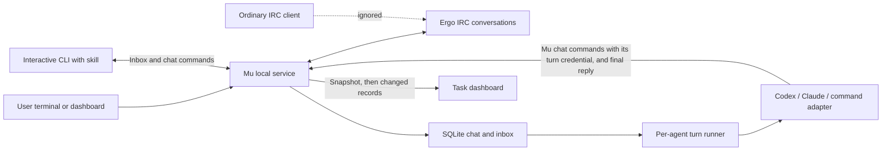

# Architecture

Mu separates agent policy from local coordination mechanics. The team lead is a skill loaded into a CLI agent. It decides which workers to launch and what to ask them; the service does not plan tasks or call a model API.

The lead delegates outcomes, essential context, and genuine constraints to workers that own their execution methods. The user's existing authorization carries through the assignment. Routine operational choices and expected technical difficulties are resolved within the team; human questions are reserved for consequential direction, scope, or access decisions. Messages for the user summarize outcomes and material blockers without internal figures such as commit hashes or test counts, while detailed coordination stays in task rooms. Plans written by agents remain revisable and do not create new approval gates for the user. Native tool permissions and explicit project constraints still apply.

The skills call the human who runs Mu "the user". The user's name and form of address are a fact in the lead's memory, so nothing in the repository names the human. The identity ID is `user`, because the API, the credential file (`user-token`) and stored messages depend on it.

The lead does no hands-on work except reading the links the user sends and one-command housekeeping on a known target, such as removing a worktree, after a read-only check for work that would be lost. Anything that check flags goes to a worker or the user. This saves a worker spawn for trivial steps without letting the lead drift into investigation.

A reviewer and an implementer settle findings directly, instead of through the lead: a relay costs a lead turn per hop, and the lead's context is the largest on the team. The loop is bounded by policy rather than by code: every message is a verdict, a fix, an escalation or the final report, never an acknowledgment; the reviewer has three verdicts, after which a remaining finding goes to the lead; the implementer closes the loop with one report to the lead after the pass. Mu's automatic routing stops two agents that reply without mentions after one hop, so a forgotten mention cannot loop either.

Messages between agents are telegraphic, and each worker gets a short personality in its task text. Both set tone only; a personality never overrides the skills, the scope or safety.

When the user asks the lead to dream, workers review the team's traces: chat, task results, native transcripts, and usage. They fix Mu's own skills, docs, and tooling, and record the findings, changes, proposals, and expected savings in an artifact in the data directory. Spend totals come from what Mu records per session, which for Claude Code is the CLI's own figure and includes subagents; transcripts supply only the breakdown, and a dream checks its transcript sums against the recorded totals. Changes outside Mu stay proposals for the user. Every dream also checks three standing directions against the period's evidence, and reports "nothing found" where there is none: the local environment (tools, permission rules, service configuration), the instruction files and the lead's memory, and the team's communication. Each dream also writes the period's achievements as daily files in `brag/` in the data directory, for the brag view, and audits the lead's memory in `memory/lead/` of the Mu home: a worker checks the transcripts for where the lead wrote, and the lead checks the content itself, because workers never read the memory. Between dreams the lead saves durable facts to that memory in the turn it learns them, and applies the memory changes the audit finds itself.

SQLite in `mu.sqlite` in the data directory (`~/.mu/data/` by default) is the authoritative shared state for the registry, tasks, conversations, memberships, messages, delivery state, and native session references. The lead discovers current work through the registry and task commands. Per-turn prompts supply the current conversation and point to `task list` instead of embedding task records, which would grow with every verified task; `task list` hides verified tasks unless asked. The lead also gets up to 20 active tasks that have no waiting card and whose workers are all idle, done or stopped; an omitted count points it to `task list`. Its direct-chat turn carries up to 20 recent lead-authored messages from other sessions, shortened to 400 characters each; a persisted cursor and message IDs keep its own replies out of later carryovers. Neither model memory nor the Markdown skills are the state database.

Mu's instructions, projects map, configuration and runtime data live in a separate home, `~/.mu` by default, outside the checkout. Only the server entry point, the launchd installer and the CLI resolve `MU_HOME`; `createApp` and the runner receive an explicit home. Startup validates it before opening the service. Each turn reads its role skill from that home and names the projects map in the prompt. The user can initialize it from a shell, while a managed lead can request the same operation through the service; workers are refused. `service` reports whether shipped defaults need an upgrade, and the restart check starts the new code with the same home before allowing a cutover.

The service runs on one event loop, and its SQLite calls are synchronous: while a query runs, Mu answers no HTTP request and handles no IRC traffic or timer. A broker restart or several active agents cause many changes in a row, and each change reaches the dashboard, so the work done per change must not grow with the history. A dashboard state that holds the latest messages of every conversation, rebuilt on each change with an unindexed read per conversation, takes 1–10 seconds per rebuild: Mu stops answering during a broker restart and sends take seconds afterwards. The dashboard now receives only the records a change touched (see [Dashboard updates](#dashboard-updates)). Reads of the messages and inbox tables are served by indexes, including an expression index for JSON fields, and a test fails when such a read would visit every row. A delay monitor writes one dated warning when the event loop stalls for more than one second; it logs again after the loop recovers and a later stall occurs.

## Chat is the coordination channel

Ergo implements IRC; Mu uses `irc-framework` as a client. Browser and CLI messages are sent to the conversation's channel and recorded when received through IRC. Common uses the configured public channel; direct chats and task rooms use separate secret, invite-only channels. The observer sees every conversation for the local user's dashboard, and each agent joins only its conversations. Mu adds agent routing, persistent inboxes, and a task view; it does not implement a replacement chat protocol.

Each agent has a direct conversation with the user. Direct messages automatically deliver to the other participant without mentions. In common and task rooms, mentions select recipients among the room's members. `@all` selects those members except the sender; `@user` never launches a process. Mentions inside code spans, fenced blocks, emails and scoped package names such as `@scope/pkg` do not count. Unaddressed group messages are visible without scheduling turns. A managed agent's final reply reaches the agent whose message started the turn unless the reply addresses another member: when it mentions neither the requester, another member, nor `@all`, Mu prefixes it with the requester's mention and flags the message as automatically routed. A reply that mentions another member is the agent's own routing choice, so a reviewer's findings reach the implementer without waking the lead whose message started the reviewer's turn. A turn started by an automatically routed message gets no such prefix, so two agents that reply without mentions stop after one hop; a reply to the user's request keeps going to the lead for workers. A user message that schedules no turn, because it addresses no member or only stopped or failed agents, gets a system notice addressed to `@user`; the notice names agents without mentions, so it wakes nobody. Agent messages get no notice; Mu rejects an agent message that mentions a stopped agent, naming it, because a stopped agent never runs a turn and the message would wake nobody. Failed (`error`) agents stay mentionable, since resuming them delivers the queued message; the user may mention any agent. A final reply goes through the runner, not the API, so it bypasses the HTTP mention validation (transport delivery can still fail; a saved result is redelivered): the runner ignores mentions of stopped agents when it decides whether the reply addresses another member, and skips a stopped requester or lead for the next live recipient (the lead, then the user), so the report still reaches a live agent. Room creation and invitations define membership explicitly. Registration records the initial assignment in the chosen task room, or in the new agent's direct conversation when the user creates it.

Messages, pending deliveries, and native sessions carry their conversation identity. A managed reply is sent back to its originating conversation. Task rooms retain `sourceConversationId` so the lead can send a summary for the user to the conversation where the request originated. Skills use scoped history instead of treating a global transcript as their context. The dashboard loads the latest 300 messages of a conversation when it first opens it; the history endpoint and the CLI's `history` page with `before` for older messages and `after` for newer ones. `agents --id` and `--status` and `task list --conversation` filter in the CLI, not in the service: the registry keeps every retired agent, and an agent CLI truncates a command output of that size, so the lead could not read the unfiltered list.

IRC channels carry messages only; history lives in the database. Ergo allows each client 100 channels by default (`max-channels-per-client`), and every agent and task room has a channel, so joining all of them at start would pass the limit once Mu had about 100 conversations: the 101st join fails with "You have joined too many channels". Mu therefore joins a conversation only when a message needs it. The observer, which is in every active channel, holds at most 80 (`maxChannels`). Joins run one at a time, so concurrent first joins cannot pass the cap. To join another channel, every member and then the observer last leave the least recently used channel that has no message in flight; the observer leaves last so it can always invite members back. A message to a channel that is leaving waits for the departure to finish and then rejoins it. If every channel has a message in flight, the join waits for one to finish and fails with the limit after 30 seconds. The broker drops an empty channel, and the next message to that conversation creates it again, sets it secret and invite-only, and invites its members. No message or history is lost, because Mu records a message only after its own send is confirmed on IRC. Common is never left.

The local database records message history and pending deliveries. A manual inbox read returns unacknowledged messages without consuming them. Managed turns save completed output before posting it and acknowledge their messages only after delivery succeeds. A delivery failure can therefore resume the saved reply without repeating completed work. The saved reply names the messages its turn covered, and only those are acknowledged when it is delivered; messages that arrived meanwhile get a turn of their own. A turn without completed output that a clean service shutdown interrupted is retried on the next start, and a turn interrupted by a crash requires inspection before retrying; execution is not exactly once. Failure notices are posted in the affected conversation and can reach the coordinating lead.

## Task lifecycle

Tasks are independent records linked to a coordination room, the user's source conversation, and assigned workers. They move from `active` to `ready` when the assigned deliverable and result are recorded. Only the user's verification action can move a ready task to `verified`. Registering a worker with initial work requires an existing task or creates one, and assignment is persisted before its first message is queued.

A blocked agent records its obstacle while the task remains `active`; tasks have no `blocked` status. The team keeps independent work moving and marks the task `ready` only when its assigned scope is complete.

Verification is durable before its IRC notification is sent. The record includes the notification's success or failure so the UI can offer an explicit retry without changing verification time. Verification retires the task's workers in the same operation, so a routine verification costs no lead turn: the system notice names the retired workers and mentions `@lead` only when a worker was skipped. The lead can run the retirement operation again later. Retirement requires verified metadata, excludes the lead, and keeps any worker with other unverified assignments, a turn in progress, a saved response, or pending messages. One exception: a managed worker that failed (status `error` with the runner's `lastError`) and whose pending messages all belong to rooms whose tasks are all verified is retired. A failed managed agent runs no turn until someone resumes it, and resuming a stopped agent works the same way with the same inbox, so retiring it cancels nothing that could still run. Mu cannot tell a permanent failure from a transient one, so the rule rests on whose work the messages are, not on the error. A message from any other conversation may be a request the user still wants answered, and a saved response is finished work waiting for delivery. A manual agent is never covered: it reads and acknowledges its own inbox in any status, so `error` does not mean it has stopped working on a message. Stopped worker records and conversations remain available. A user can explicitly stop any agent, in any status, independently of this normal lifecycle. The dashboard's own requests are tested against a running service, because a request the API rejects otherwise fails only in the browser. A state update clears only errors about reading the state, so the error of a failed action stays visible while agents work. Archiving is a dashboard view, not stored state: the client derives it from task records alone, so archived items are only hidden, and they become visible again as soon as they are tied to unverified work.

Markdown is rendered locally with pinned Marked and DOMPurify dependencies. A tag and attribute allowlist preserves formatting while removing scripts, unsafe links, controls, styling overrides, and application-action attributes from untrusted chat or task text. Names and identity labels remain plain text. After sanitization, the UI replaces an inline code span whose entire text is a registered agent ID or a known task ID with an application-built reference: the shared `@name` agent reference that opens the agent's private chat, or the task's title, which opens that task in the workspace. A code span of the exact form `#123` that names an existing message becomes a link that opens the message's conversation, scrolls to the message, and highlights it briefly. The dashboard holds only the conversations it opened, so it cannot look every message up; it links any ID up to the newest one it knows, because message IDs count up from 1 without gaps and no message is deleted, and asks Mu for the message's conversation when the link is followed, loading earlier pages until the message is shown; every message in the chat also shows its ID in a muted color, so the user can read the references the lead writes. Only the backticked form links, because agents write PR and issue numbers as plain `#123` and those must never resolve to chat messages; a `#123` that matches no message stays a literal code span. Other code spans, code blocks, and code inside links stay literal.

## Dashboard updates

Sending the whole workspace, including the latest 300 messages of every conversation, on every change costs 2.5 MB of JSON per change at 231 conversations. The dashboard therefore opens one event stream (`GET /api/events`) that starts with a snapshot and then carries batches of changed records.

- **Snapshot.** The agents, tasks, waiting cards, activities, conversations, the chat transport, the adapters, and the newest message ID of each conversation. Agent records include the conversation of a managed turn while it runs, so chat activity can be scoped to the open conversation and members working elsewhere can be identified without inferring from global status. It holds no messages: the dashboard loads a conversation's latest page when it first shows it, and the newest IDs are enough to start the unread counts and the tint of new messages. `GET /api/state` keeps its full shape for the CLI.
- **Batches.** A store `change` names what changed as `[kind, id]` pairs, with a null ID for the whole kind, and Mu collects the changes of one event-loop turn into one batch. For each named record it compares the record with the JSON it last sent and sends the whole record when it differs, or null when the record is gone; new messages are sent as they are stored. A record is sent whole, not as a field patch, so applying a batch twice changes nothing. A dashboard that connects while changes are being collected gets those changes sent to the other dashboards first, so that its snapshot and what Mu last sent agree; otherwise a record that changed and changed back within one turn would look unchanged and keep the new dashboard's intermediate value. After the service closes the stream, a change sends nothing, because the store may already be closed. The store refuses a `change` that does not name its kinds, because a change that named nothing would leave every open dashboard stale. Activity changes name the whole list, since a move renumbers its lane; the list is short.
- **Order and gaps.** Each batch has the next sequence number, and its event ID is `epoch:seq`, where the epoch is random per process. Batches arrive in order on one stream. When the browser reconnects it sends the last ID it received (`Last-Event-ID`), and Mu replays the batches after it from the last 1000 batches it keeps, up to 8 MiB. Any other ID gets a new snapshot: one from another process, one no longer kept, or none. The dashboard also checks that each batch follows the previous one; on a gap it closes the stream and opens a new one, which starts with a snapshot. After a snapshot that follows an earlier one, the dashboard fetches each conversation's messages after the newest it had (`after`): all of them for a conversation it has loaded, so the history stays contiguous, and one page for the others, which is enough for their unread counts.
- **History.** Messages that arrive for a conversation the dashboard has not opened are kept for the unread counts and references. When a conversation's latest page is loaded and older history remains, messages held from before that page are dropped, so a conversation never shows a gap.
- **Rendering.** The dashboard draws a part of the page again only when a batch touched the kinds it shows: a message redraws the conversation list and the chat, an agent change the agent cards and the summaries, and so on. A new message in the open chat is appended instead of rebuilding the log. An agent card is rebuilt only when its record changed, because a batch replaces the records it changed and keeps the others. A change of the known agents or task titles still rebuilds what embeds references. The composer activity line puts turns in the open conversation first and then names members working elsewhere; it shows a room name only when the user is a member, and labels a direct chat simply as a direct chat. It updates on the same event stream and does not poll.
- **Tabs.** Each tab has its own stream and its own copy of the state. Mu serializes a batch once and writes the same text to every stream, so a tab costs a socket and nothing per change. Browsers allow six HTTP/1.1 connections per origin, so a seventh dashboard tab waits for a connection, as before.

Measured on a copy of a long-running database (150 agents, 117 tasks, 235 conversations, 1,780 messages) with one dashboard and three changes a second: the stream carried about 1.2 KB per change instead of 2.6 MB, and its first event shrank from 2.6 MB to 750 KB, most of it task results and agent usage. The service's event-loop delay stayed at the 10 ms resolution of the measurement (p99 11 ms and max 14 ms, before 35 ms and 65 ms), and a send from the dashboard took 5 ms at the median instead of 31 ms. In the browser, the page spent 174 ms in scripts over 60 changes instead of 1,076 ms.

## Dashboard layout

Task cards and agent cards flow through three CSS columns instead of grid rows, so cards of different heights pack without gaps; the reading order runs down each column, then across. Below 640 px there is one column, because three columns would leave each card too narrow to read. Each summary block lists the items behind its number. The task counts come from the agents' statuses: a task counts when it is not verified and has an assigned agent that is working (In progress) or blocked or in error (Needs attention). The list items reuse the task and agent references of the rest of the dashboard, and task titles are always set as text. An agent's task text is collapsed by default, like a task's result, and the open state survives re-renders. A tile's chips and its icon buttons form one wrapping row. The icons are static SVGs vendored under `public/icons/` (sources and licenses in the README there) and painted as CSS masks, so they take the text color and need no script or runtime dependency; the brand marks stay trademarks of their owners. Narrow tiles drop the avatar through a container query so that the name and the status badge stay on one line.

A task card's controls are four circles of one size in a 2x2 grid in its top right corner: status and expand above, activity link and verify check mark below. Each control has its own grid cell, so a card without a verify check mark (any task that is not ready) leaves its cell empty and nothing shifts, and the expanded dialog keeps the same cells. The status is one icon per status with the status name as its tooltip and accessible label, never text, so the card header stays the same width for every status. The check mark is the same control as an activity's check-off, and the activity link is the shared picker reduced to its icon, since a task card has no room for a name. A ready task has no footer row; the footer returns for the worker count, the retirement note and the retry button of a failed lead notification. A task card expands into a modal `<dialog>` instead of growing in place: a three-column card is too narrow for long Markdown, and the dialog gives the text a 68-character measure. The dialog holds a second rendering of the same card (`taskCard(task, expanded)`), rebuilt whenever the task list is drawn again, so it shows the live task, keeps the focused control focused across the rebuild (Collapse takes focus when an update removes it), and is named by the task title. It closes when the task is deleted or filtered out of the list, because there is no card to return to; focus then goes to the active task filter. The card keeps a one-line result preview as an extra entry point. The motion is a clip-path reveal from the card's rectangle to the dialog's own box, played by `motion.expand` in `public/motion.js`; a clip, unlike a scale transform, does not distort the text. Collapsing plays it in reverse and only then closes the dialog, so Esc, the backdrop click and the collapse button all go through one `closeResult`. With `prefers-reduced-motion` the promise resolves at once, and a change of the preference mid-animation cancels the clip and the backdrop effects together, and a card that is no longer listed closes without the reverse animation; on close, focus returns to the control that opened the dialog, found again in the rebuilt list. A reference clicked inside the dialog closes it, because the reference moves the view elsewhere.

New-message tint is client-side. The user's reading position per conversation is a `{conversationId: lastMessageId}` record in `localStorage`; the server is not involved, so there is no `src/` change or restart. Local storage is shared by the tabs of one browser, which is the case that matters; a second browser keeps its own position, and the cost of that is a tint that may mark a few already-read messages there. On each open of a conversation (selecting it while the chat is visible, or switching to the chat view) the boundary is read from the record and fixed for that visit; messages above it, other than the user's own, are tinted, including ones that arrive while reading. The record advances while the chat is visible, so the next open starts from the new position and the tint clears then, not during reading. A browser with no record starts from a baseline of the existing history, so the first open tints nothing; a conversation missing from a known record is new, and all its messages are tinted.

### Modal dialogs and pickers

While a modal `<dialog>` is open the page behind it does not scroll. The browser does not provide this: wheel, touchpad and keyboard scrolling chain from a dialog to the root, and a wheel over the backdrop scrolls the root directly. One CSS rule, `html:has(dialog:modal) { overflow: hidden }`, stops the root; a dialog and the lists inside it set `overscroll-behavior: contain`, so a scroll that reaches the end of their content is not passed on. The dialog's own content keeps scrolling. Code must not call `scrollIntoView` for something inside a dialog, because it scrolls every ancestor, the locked page too; set the list's `scrollTop` instead. A reference clicked inside a dialog (an agent, task or message link) closes the dialog before it opens its target behind it.

The dashboard has no native `<select>` on screen. `public/picker.js` draws every select as a picker styled like the Conversations dropdown (the two share their CSS), and `app.js` enhances all selects in the page once at start. The `<select>` stays in the DOM, visually hidden and out of the tab order, and is still the form control: `value`, `selectedIndex`, `disabled`, FormData, `form.reset()`, `labels` and the `input` and `change` events behave as before, so the code that fills a select and reads it needs no knowledge of the picker. The picker follows the select (options, value, `disabled`) and sends focus given to the select to its trigger. Keyboard and focus follow the native control: closed, the arrows, Home, End and typing change the value at once; Enter, Space and Alt+Arrow open the list; open, the keys move a highlight, Enter, Space and Tab choose it, and Escape closes only the list, so an Escape never closes the dialog around an open list. The list is `position: fixed`, so a dialog's own scroll does not clip it, and opens upward when there is more room above the trigger. A new field type is added as a `<select>` with a label; there is nothing else to register. `<optgroup>` and `multiple` are not supported.

## Brag doc

The dashboard's **Brag doc** view shows what the team achieved, as a short written summary per day, week and month, so the user can see the output of the team and not only its cost. It is plain Markdown files in `<data dir>/brag/`, written by dreams, with no Mu command and no database table.

- **Files, not a command.** A dream rewrites the page of each day it covers; the user can edit the same files. A command would have changed `src/cli.mjs`, whose merge breaks every running agent until a restart, and it would have needed a way to correct a page. A rewritten file is idempotent: dreaming a day twice cannot duplicate anything.
- **Prose, not a task list.** A day page is a few sentences of user-readable prose about what shipped, was fixed or was decided, with the key links inline and task IDs as code spans. The user reads the page to learn what happened, and a bullet per task buries that under bookkeeping.
- **Week and month pages are written, not derived.** `YYYY-MM-DD.md` (UTC), `YYYY-Www.md` (ISO week) and `YYYY-MM.md` hold a day, week and month. A dream writes a week or month page on its first run after that period ends, and a dream after a gap writes every page that is missing, so a skipped day does not lose its summary. A period without a file has no page, and the view lists only the pages that exist. Derived pages were dropped because a list of every task of a week is the noise the written summary exists to remove.
- **Strict names, visible mistakes.** `GET /api/brag` (user only, like the workspace state) returns the files as read. A file that does not match a name above, is not a real calendar date, ISO week or month, is larger than 64 KiB, or is a directory or symbolic link is not read; the response lists it in `skipped` with the reason, and the view shows that list. Agents can write this directory, so a file is opened without following links and checked on the open handle, then read up to its limit; a symbolic link in place of the directory itself is an error; only the first 5000 names are considered, because the directory is read on each visit. A missing directory is an empty brag doc.
- **Untrusted text stays inert.** Entries are agent-written, so they pass through the chat's markdown sanitizer with images forbidden, under the dashboard's content security policy, which also allows no remote image. References to tasks and agents need the workspace state, so the view is built only when both the files and the state have arrived, and again when the known tasks or agents change. The page list is `public/brag.js`, the sections are `public/brag-view.js`, and the file listing is `src/brag.mjs`.

## Waiting for you

The dashboard lists, above everything else, the decisions that block a task, as plain-sentence cards. It is separate from the task list: a task awaiting verification already has its own card, and a blocker does not change a task's status. The lead alone adds and removes cards (`waiting add`, `waiting remove`); the user and workers can only read them. The lead removes a card itself once the decision is made, because Mu cannot tell when a decision was made. Cards live in the `waiting` table of the shared database, so they survive a restart and arrive in the dashboard state like tasks.

A card is linked to the task it blocks (`taskId`) because the text may not carry an identifier. The link is optional, since some decisions concern no particular task; a given ID must name an existing task that is not verified. The dashboard shows an icon on the card that reveals that task, with the task's title as its tooltip. A card without a `taskId`, including one stored before the link existed, shows no icon. Clicking a card's text opens the lead's direct chat with a `> Re: <card text>` quote line in the composer and the cursor on the next line. The quote is how the lead matches a reply to a card. A draft already in that chat is kept above the quote.

Card text is words only. The skill states the rule, and the API enforces the cheap part of it: it rejects text containing a `#123` reference, a URL, or the ID of an existing task, so a slip fails loudly instead of showing an identifier the user cannot resolve. It does not try to detect every identifier; a card is a sentence the lead writes for a human. Text is limited to 200 characters on a single line. Removing a card is a hard delete; the lead's chat messages keep the history.

## Focus list

The user's personal todo list sits on the dashboard under "Waiting for you". It is separate from tasks: a task is work for agents with a lifecycle Mu enforces, an *activity* is something the user tracks, which may involve zero, one or several tasks. An activity has a short text, a lane, a position and a check-off time. The lane says who holds the ball: `focus` is the default and holds work the user or the user's agents are doing; `control` means the ball is with another person outside the user's agent team, and the user is waiting for them.

Activities live in the `activities` table and the links in `activity_tasks`, both in the shared database, so they survive a restart and arrive in the dashboard state like tasks. The link table is keyed by task ID, which enforces that a task belongs to at most one activity: linking again moves the task. Links are kept apart from the task records on purpose. A task record is owned by the task lifecycle, and a verified task cannot be edited, yet the user still wants to link and unlink archived tasks. Checking an activity off keeps its links, so its squares still show.

Positions stay contiguous from 1 within each lane's open activities, and a move is an insert followed by a renumbering inside one transaction, so the API takes a lane and a target position and never a neighbour. Checked-off activities leave the lanes and sit in the archive, the most recent first; restoring one puts it at the end of its lane. Deleting is a soft delete: the activity gets a `deletedAt` time, leaves every list and frees its tasks, but its row and history stay, because reports about past work should not lose what the user dropped. A confirmation in the dashboard guards it, since the API has no undelete.

The history is the `activity_events` table: `created` with the lane it started in, `moved` with both lanes (only a change of lane counts, not a reorder), `checked`, `unchecked` and `deleted`, each with its time, in the same transaction as the change. It is write-only for now: `activity history` and `GET /api/activities/:id/history` read it, and the dashboard shows none of it. Activities from before the table existed get a `created` event at their creation time, with their current lane standing in for the unknown first one, and a `checked` event when they were already checked off. This runs on every start and adds nothing twice.

Auth differs from the waiting list: the user and the lead both change activities, because the user edits, drags and checks off cards in the dashboard while the lead creates, links and moves them for delegated work. Workers cannot. Text is a single line of up to 200 characters; unlike waiting cards it may hold references, since the user writes it too.

A task square follows the task's own status, because Mu has no separate "inactive" state: `verified` is archived, `active` is active, and `ready` is inactive, since nobody is working and the next step is the user's verification. The active theme supplies distinct colors for these states, and the tooltip names the status.

The dashboard builds the list in the client from the state like every other section. A lane lays its cards out in two CSS columns, the same flow as the task and agent lists, so a dropped card goes after every card in an earlier column and every card above the pointer in its own. A drop shows its result at once, computed by the same renumbering the server applies, and the next change of the list on the stream replaces that guess; if the server rejects the move, the guess is dropped and the card returns. While the user types in a card or drags one, the list is not rebuilt, because a rebuild would lose the field or the dragged card; the next render after the gesture catches up. A card that does not exist yet is a draft in the browser only: it is created when its text is saved, so an abandoned draft leaves nothing behind. Deleting asks on the card itself and keeps its question open across state updates. The task-link dropdown is the shared picker, created at run time by `createPicker`, and an open dropdown holds the task list's rendering back for the same reason.

## Dashboard themes

`public/themes.js` is the dashboard's single theme registry and synchronous bootstrap. It runs in the document head before the stylesheet and body, reads the browser's saved theme ID, and applies a complete set of CSS custom properties before first paint. This uses the existing content security policy: an external same-origin script sets individual style properties, with no inline script or stylesheet. An unknown saved ID selects the original theme. Selection is local to the page origin, persists in local storage and follows storage changes from other tabs.

The original palette and foundation tokens retain the existing appearance. Semantic color roles let the seed-derived themes replace colors without losing inverse text. Status meanings have dedicated color families, independent of decorative accents; task badges and activity squares share those meanings. Tests check all pairs of status inks in OKLab space as well as AA text contrast, so different numeric values cannot conceal nearly identical colors. Typography, radii, shadows, spacing accents, gradients and motion use the same token contract; layout constraints, icon geometry, transparent surfaces and inherited colors belong to the shared components. [Development](development.md#add-a-dashboard-theme) records each seed's design score and the theme authoring workflow. Tests enforce token completeness and references, prevent literal styling values from creeping back into component CSS, and cover contrast and picker behavior.

The rail's theme control uses the shared accessible picker. Applying a theme commits foregrounds and backgrounds together with transitions suppressed for that update, preventing a dark text color from briefly crossing an old dark background. Existing JavaScript animations are cancelled, and subsequent effects read the active tokens. The busy-name clock reads the same duration token as its CSS animation, so a theme change keeps the wave synchronized. The system reduced-motion preference continues to override every theme.

## Launching and follow-up delivery

The managed runner starts one CLI process per turn and permits only one active turn for an identity. Messages that arrive meanwhile wait in that agent's inbox.

A turn delivers a burst, not one message. It takes the agent's oldest pending message and every pending message of the same conversation after it, oldest first, up to 256 KiB of text (always at least one message); messages of other conversations wait for their own turns, which keep their own sessions. A worker that sends several progress notes during one lead turn therefore costs the lead one turn instead of one per note, and the lead reads them together instead of summarizing each half-informed. The messages are acknowledged together, in one transaction, after the turn's reply is posted: all of them or none. A failed turn leaves all of them pending, and the retry delivers them again with any that arrived since. A clean shutdown records the turn's newest message as interrupted; the resumed turn names the interrupted messages in its prompt. The newest message stands for the turn in `MU_MESSAGE_ID` and `activeMessageId`. An unaddressed reply reaches every recipient that a reply to each of the turn's messages alone would reach, so a lead's question and a reviewer's verdict in one burst both get the answer, and replies to automatically routed messages still go only to the fallback. The budget keeps a long backlog, such as one that built up while an agent was stopped, from filling a model's context in one prompt. Codex and Claude Code record a session for each agent-conversation pair and resume that specific session. A direct request cannot reuse a task room's native model context. A session receives the full role skill on its first turn and again whenever the skill file changes. Other turns get a one-line reference, because a resumed session still holds the earlier copy and repeating it grows every later model call. Mu re-sends the full text when it cannot rule out compaction: when the CLI reports no context size, or when the reported context shrank. A turn's status and a task's completion are separate: successful process exit leaves the agent idle unless it explicitly reported a task status.

A worker's turn prompt names the size of its session once it holds 300k tokens or more. A resumed session re-reads its whole context on every model call, so a follow-up to such a worker costs several times what a fresh worker with a handoff costs: two workers that took review rounds and a second review at 300k–730k tokens spent $62 of their $73 in model calls above 250k. The lead skill already told the lead to start a fresh worker, but a review loop runs without the lead, and the lead did not look at the size before each follow-up. The notice puts the fact in front of the agent that is about to pay for it, and the worker skill tells it to answer a new phase with a handoff. Mu does not refuse the turn: a small follow-up that needs the context is still cheaper there, and only the worker can tell which one it has. The lead gets no notice, because its sessions compact by configuration. A worker whose CLI compacts below that size never reaches it either, as a Claude worker does with an `autoCompactWindow` of 300000; the notice then matters only for workers without a compaction setting.

The `say` command answers with a note when an agent in a managed turn posts to that turn's own conversation: the final text of the turn is posted there too. The turn prompt already says so, but a context compaction in the middle of a turn replaces the prompt with a summary, and the agent then answers twice. The lead's direct-chat session did that in 7 of its 15 compaction turns and in none of its 362 other turns (counted over one lead's sessions). The note is part of the command's output, so it reaches the agent after the compaction, at the moment it could repeat itself. It only informs: a progress note in the own room, and a report posted with `say` before `NO_REPLY`, stay valid.

A manual identity has no process controlled by Mu. Its interactive CLI loads the same role skill, waits with the inbox command, and acknowledges completed message handling. This supports arbitrary CLI agents without assuming a common terminal-input protocol. It is cooperative; no background subscription can force a model to take a turn. A terminal multiplexer can launch the initial terminal without becoming a second follow-up channel.

`stop` terminates a managed process group and pauses that identity. A clean service shutdown, on SIGINT, SIGTERM, or SIGHUP, terminates running turns without pausing their identities. It waits for the processes to exit and records the interrupted message, and the next start runs that message again in the same native session, with a prompt note to inspect partial work. After a crash, Mu cannot know whether a detached CLI process is still running, so the identity moves to `error`. Process failures and turns interrupted by a crash require explicit operator action. The service does not automatically retry failed turns, resume an unrelated session, or switch to another transport. Native CLI tool approvals remain in force; unattended runs cannot complete actions their CLI denies. Signalling a process group that has already exited but is not yet reaped is not an error: macOS refuses the group signal with EPERM while the group holds only its exited, unreaped leader, so Mu signals that leader directly; once Node has reaped it, its process ID may belong to another process and gets no signal. Any other signalling failure stays fatal, but a shutdown still terminates every other turn first, so each is recorded as interrupted and resumes.

An agent can carry its own model, set at registration. Mu passes it to the CLI after the adapter-wide `cliArgs`, so it wins over a model configured there. Mu rejects a model for adapters that have no model option, instead of silently ignoring it. The lead skill owns the policy for choosing a model: it names an exact model on every spawn, because a CLI's configured default can change without Mu noticing. Mu only provides the mechanism.

A reasoning effort works the same way: stored on the agent, passed on every turn after `cliArgs` (Claude Code `--effort`, Codex `-c model_reasoning_effort=…`, pi `--thinking`), and chosen by the lead skill. Each CLI takes the last occurrence of a repeated option, so the agent's effort wins, and each applies the given effort to a resumed session too. Mu validates the level against a per-adapter list that one-turn probes established, because Claude Code and pi only print a warning for an unknown level and run at their default, which would hide the mistake. Codex passes any level to the model API, which rejects an unknown one; its list is the one that error named. The effort is read from the agent record for the card, not from usage reports: Codex records it in the rollout's `turn_context`, but Claude Code and pi do not report it in a form Mu reads.

Codex runs with a Mu permission profile that Mu builds per turn: workspace-write filesystem restrictions and network access for coordination, plus an unreadable data directory, apart from the agent's own credential file, and unreadable agent CLI state and browser profiles (see [Caller identity](#caller-identity)). Codex's built-in workspace profile keeps only the working directory's top-level `.git`, `.agents` and `.codex` read-only, which made a Codex worker unable to fetch, create a worktree or commit, while nested repositories, `.claude` settings and a `core.hooksPath` inside the work tree stayed writable. Mu's profile changes both. It adds the configured `codexSandbox.writableRoots`, such as a directory for the worktrees of Codex agents, and, in the git directory of the agent's repository, the entries that fetching, creating a branch or worktree, and committing in a linked worktree write (objects, refs, logs, `worktrees`, `FETCH_HEAD`, `packed-refs`, `shallow`, and a linked working directory's own git directory). It grants these entries rather than the git directory, because a writable git directory could be renamed and replaced with one that holds the worker's own hooks; so the directory entry, its `config`, hooks, `index` and `HEAD` stay read-only, and inside the sandbox a worker commits only in linked worktrees and cannot record an upstream branch. Read-only on top, because the most specific path wins in Codex: the hooks and configuration files that git reports, submodule git directories, the `commondir`, `gitdir` and `config.worktree` files of the agent's own linked worktree and of every linked worktree outside the writable roots, which redirect where git reads configuration, the `.git` entry of every repository found up to three levels below the working directory, and the `.git`, `.claude`, `.codex`, `.pi` and `.agents` entries of the working directory, its repository's top level and each writable root. Inside a writable root Mu lists nothing more, for two reasons. Such a root is shared: every Codex worker can write every directory in it, including other agents' worktrees and hooks that live in a work tree, such as a repository's `.husky/_`, and a probe planted such a hook from an unrelated working directory, which ran at the next unsandboxed commit. Listing the `.git`, `.claude`, `.codex`, `.pi` and `.agents` entries of each directory in a root therefore protected little, and it was expensive: Codex builds the sandbox of each command from the profile, in time that grows faster than the number of listed paths (about 0.5 s for 100 read-only paths, 4 s for 400, 14 s for the 800 that a worktree directory with dozens of linked worktrees produced), so every command a worker ran took that long. Codex's deny patterns would be cheap, but a deny also blocks reading, and checking out a repository that tracks files under `.claude` and `.agents` writes them, so a deny would break `git worktree add`. The entries had guarded the attacks that need no action of the victim, a redirected `.git` file that a start-up `git status` follows and planted session settings, so a writable root must hold only Codex worktrees: the worktrees of Claude agents and of the user stay outside every root, which the team-lead skill requires. Codex workers can still write each other's worktrees there. Codex's profile language has no patterns for writes, so the protected entries are paths Mu lists before each turn, and they protect only what existed when the turn started. A worktree or repository that a worker creates during a turn can carry git configuration, hooks and agent settings of its choice: it can point a new worktree's `.git` file at a repository it set up with `core.fsmonitor`, and the next git command or agent session outside a sandbox there, such as a Claude reviewer's start-up `git status`, runs that code. The next turn's protection then keeps the planted files instead of undoing them. No list of paths can prevent this, because a worker can always hand over a repository it created itself; the team-lead skill therefore keeps unsandboxed agents out of directories a Codex worker wrote. Before anyone checks out, switches to, commits on, merges, or runs the tests of a branch that a `codex` worker committed, check its diff from the refs without checking it out (`git diff origin/<default>...origin/<branch> -- .githooks .claude .codex .agents .pi package.json`). In a repository whose `core.hooksPath` is inside the work tree, as Mu's `.githooks` is, git runs the branch's own hooks from the first checkout or merge on. Creating the worktree from the main checkout does not run them. A symbolic link that a worker creates in a writable place grants nothing, because Seatbelt checks the path that the link resolves to. Code inside a writable work tree, such as test scripts, is not protected at all; that boundary is the same for a Claude worker. Mu refuses a writable root inside the data directory or another unreadable path, because the more specific grant would win there, and a root that contains an unreadable path, such as the home directory: the deny would still win, but the rest of the home directory would become writable. A step outside the sandbox goes through Codex's escalation: the agent asks to run that one command outside it, with a justification, and Codex's reviewer approves or rejects the request. Codex 0.167 runs an approved command with the whole file system writable and keeps only the profile's deny entries (`for_approved_command`): Mu's data directory and the private paths stay unreadable and unwritable, but the agent's own credential, a read exception inside the denied data directory, and every read-only entry are gone, so the command can write its repository's hooks and cannot run the Mu helper. `tests/codex-escalation.test.mjs` drives real `codex exec` turns against a scripted model to pin this down, and that `approval_policy="never"` rejects every escalation request. For an escalated command the reviewer is therefore the boundary, not the profile: the denies stop direct reads of Mu's data and the credentials, but the command can write Mu's checkout and configuration, shell startup files and launch agents, and run a build the worker wrote, and what it plants runs later outside every sandbox, where the user credential is readable. This is the counterpart of Claude's auto-mode classifier, with the same risk, and it is what an interactive Codex session relies on: the worker skill tells a worker to request the escalation for a step the task needs instead of stopping, and treats a rejected request as the denial. Mu passes `approval_policy="on-request"` and `approvals_reviewer="auto_review"` on every turn instead of inheriting them from the user's configuration, because a non-interactive turn has no user to ask; without them, a turn with a fresh `CODEX_HOME` got no review at all. It also passes `--ignore-rules`, which drops repository `.rules` files too and any forbidden rule added later: the user's execpolicy rules allow commands such as `git fetch` and a project's build script for interactive use, and Codex treats a command that an allow rule matches as needing no review, while a profile with deny entries keeps it sandboxed. A Codex worker therefore could not get such a script out of the sandbox even by asking, while the same command through `/usr/bin/env`, which no rule matched, was reviewed and ran. Full sandbox bypass (`danger-full-access`) would give Codex Claude's reach for every command, but also the user credential, every agent's credential file and the CLI transcripts, so Mu does not use it. pi has neither approval prompts nor a sandbox, and in print mode its tool hooks can only block calls by rule, without asking anyone. Mu therefore wraps the whole pi process in a Seatbelt profile that it generates per turn: closed by default, reads unrestricted, writes limited to the workspace and the agent's own pi directory, and outbound connections limited to listed loopback ports. Seatbelt cannot filter by host name, so a model provider must be reached through a local proxy; this makes a pi worker's network narrower than a Codex worker's. Paths whose code runs outside the sandbox the next time git or an agent CLI starts stay read-only: `.git`, `.pi`, `.claude`, and `.codex` entries at any depth, because git and the CLIs also discover them in subdirectories, and the hooks and configuration files that git itself reports for each writable repository, because the configuration can move them into the work tree. Mu asks git for them before each turn and refuses implicit bare repositories while it asks, so files a worker planted cannot pose as a repository. The Mu checkout and data directory stay read-only as well: every agent runs the checkout's CLI and skills, and the data directory holds the shared database and the other agents' pi directories, whose paths become sandbox grants on their next turns. Mu resolves every granted path again at the next launch, so a worker must not be able to redirect one: the profile denies creating, removing, or renaming each directory entry that resolving a granted or protected path passes through, including the granted directories themselves, their ancestors, and symbolic links on the way, while the directories stay writable inside. Without this, a worker could replace its pi directory or workspace with a link to Mu's data directory or the user's home and receive write access there on its next turn. Mu also creates the pi directory and its temporary directory outside the sandbox only as plain directories and refuses a launch when one is a symbolic link, instead of following or recreating it. The rule cannot tell a link that a worker made from one the user made, so Mu does not reject linked workspaces; it only keeps the worker from changing them. The profile cannot restrict what a worker does through an allowed port, so Mu's own port is not one: pi reaches Mu only through its own socket, as described in [Caller identity](#caller-identity). pi gets a per-agent configuration directory for the same reason: a writable `~/.pi/agent` would let a worker install an extension that a later, unsandboxed pi process loads. Where Seatbelt is unavailable, Mu refuses pi agents instead of running them unconfined. Claude Code receives an explicit command allowance for Mu's helper; the launch prompt supplies the identical command text. The helper is invoked alone; adding unrelated shell operations changes the command being authorized. Other permissions remain native to the CLI. `roleCliArgs` adds arguments for the lead or for workers only, after the adapter-wide ones; the lead uses it for native auto-compaction, because its one long session otherwise grows toward the CLI's default threshold near the end of the window. `cliArgs` configures additional native arguments for a chosen project policy without changing the adapter's session and output protocol.

The documented managed-Claude configuration selects auto mode for every new or resumed turn. Claude approves routine edits and evaluates commands with its permission classifier. Mu independently disables interactive permission prompts, so a call that still needs human approval fails explicitly. Selecting a mode is an operator configuration decision; the service does not elevate permissions in response to a failure. The assigned directory and any configured additional directories remain relevant to native access checks.

A stopped or failed identity can be reconfigured to another adapter, model, directory or reasoning effort after its process exits, and its native sessions can be forgotten with `newSession`. Only the user may do it. Changing adapter or directory clears its recorded native sessions; changing the model or effort keeps them, because each CLI applies a model and effort passed on a resumed turn (Claude Code 2.1.319 continued a Haiku session on Sonnet when the turn passed `--model sonnet`). A kept effort must be valid for a new adapter, so a switch cannot leave an agent with a level its CLI would ignore. A kept model is not checked against a new adapter: manual and demo agents ignore it, and another CLI rejects an unknown model on its first turn with its own message, but a switch to pi needs a model, and pi's model cannot be cleared. `newSession` empties `sessionId` and `sessionIds` for every conversation and nothing else, which is how the one lead identity starts from an empty context: it cannot be deleted or registered again, and its history, tasks and queued messages belong to Mu, not to its native sessions.

The model and effort of a turn come from three sources, in this order of precedence: the agent record, `roleCliArgs[role][adapter]`, then `cliArgs[adapter]`, each placed after the previous one on the command line, and the CLI takes the last occurrence. Mu reads the record from the database at every turn but the configuration file (`~/.mu/config.json` by default) once, when the process starts, and passes the parsed values to the runner. Editing the file therefore changes nothing until a restart, and stopping and resuming an agent does not reload it. The service's code digest includes the file, so `service` reports the running process as stale after an edit; that is the signal that a configured model has not been applied yet. A lead whose record names a model ignores the model in `roleCliArgs.lead`, which is why the lead is registered without one. Mu does not show the effective arguments: the card and `agents` show the record's model and effort and, per conversation, the model that the CLI reported for its last turn, which is the only evidence of what ran. Claude Code and pi report no effort, so an effort from the configuration file is not observable from Mu. Pending deliveries remain, so inspect them before setting the identity back to idle. The one lead identity can therefore switch between interactive and managed CLIs without deleting its conversations.

## Mu home

`MU_HOME` defaults to `~/.mu` and holds the user's local instructions, project map, and lead-memory seed. The `init` command installs the repository's lead and worker skills as tracked defaults. Its private manifest records each default's hash and install time, the source checkout, and the text used as each merge base; `.backup/` preserves replaced versions. `projects.md` and `memory/lead/MEMORY.md` are one-time seeds and remain under the user's control.

An unedited default follows the shipped version. A local edit is kept while the default is unchanged, and a later default change uses `git merge-file` to combine both. A conflict is reported before any home files are changed; the user edits the live file and uses `init --accept FILE` to record the new shipped version as its merge base. `init --adopt` changes which checkout owns the manifest. The command resolves physical paths before checking that the home is separate from the checkout and that the data directory neither holds the home nor overlaps one of its own entries (`skills`, `memory`, `projects.md`, `config.json`, `.install`, `.backup`); a start checks the same. It refuses symbolic-link or foreign-writable directories and files with multiple hard links, and writes private directories and files.

The data directory (`MU_DATA_DIR`) defaults to `data/` in the home and the configuration (`MU_CONFIG`) to `config.json` there. In the home they survive a fresh clone or a second checkout, and the checkout holds only code. A checkout of an earlier layout that still holds its files in the checkout, a database `.mu/mu.sqlite` or a `mu.config.json`, must have them moved with Mu stopped, because the running service holds the database open and every running agent reaches it through the data directory. A start that took the new defaults meanwhile would open an empty database and a new user credential in the home: the team's registry, tasks and conversations would seem lost, and the dashboard would be signed out. So the entry point and the installer refuse while a default place is empty and the checkout still holds its file: a `.mu/mu.sqlite` with no `mu.sqlite` in the home's data directory, or a `mu.config.json` with no `config.json` in the home. The refusal is one line that names each `mv` and the uninstall and install around it, before anything is created in the home. An explicit `MU_DATA_DIR` or `MU_CONFIG` turns the rule off for that place, which is how the tests and the start check run. Once a file is in the home, a copy that comes back into the checkout is ignored.

One data directory serves one service. A second one on the same directory would run its migrations on the live database, issue credentials for the same agents and take their sockets, and because the data directory is not tied to a checkout, two checkouts with default settings would share it. `createApp` therefore takes SQLite's exclusive lock on `service.lock` in the data directory before it opens the database or the credential, and holds it until it closes; `service.lock.json` names the holder, and the refusal names its process, checkout, port and start time. The lock is an fcntl lock, so the kernel drops it when the process ends, also after `kill -9`, and no stale lock is left to judge, which a PID file could not promise: it survives a crash and its PID can be reused. SQLite also refuses a second connection to the locked file within one process, so two apps in one test process are kept apart too. Node closes a database that is no longer referenced when it collects it, which would drop the lock unseen, so the module keeps each held lock referenced until it is released. The start check takes no lock on the live directory, because it runs on its own temporary copy.

The runner reads the role files from the home on every turn. In the user's shell `init` runs in the CLI; a managed lead's `init` goes to the service, which runs outside every sandbox and installs its own checkout's defaults. Workers are refused.

The layout rests on a few choices. The live role files keep the names `skills/<name>/SKILL.md` and their Agent Skills format, so an interactive CLI can load one as a skill. Memory is per role (`memory/lead/`), which leaves room for another role's memory. `init` installs two kinds of file: a default (the two skills) is tracked and upgraded, while a seed (`projects.md`, `memory/lead/MEMORY.md`) is created when missing and never touched again. `config.json` and `data/` are not installed: the user writes the first and the service creates the second. `.install/` keeps the text of each default as installed, because without that base `init` could only tell that both sides changed, not merge them. The home has no Git history of its own: `init` backs up each file it changes, and a repository there would add a `.git` directory that every sandbox must protect, with nothing to commit it. The projects map is not injected into the prompt: it costs about 1,700 tokens, most turns do not need it, and a one-line pointer reaches every harness and working directory. Only the user, by hand, and `init` edit the live instructions. A dream's workers fix the shipped defaults on a branch, with review and Git history, and the lead then runs `init`, so every change that agents make to their own instructions keeps its review.

Rejected alternatives for the home:

- Reading the checkout's `skills/` when the home has no file: a fallback would hide a home that was never initialized or is damaged. A missing role file is an error that names `init`.
- Links from the home to the checkout's `skills/`: the live instructions would still be the source folder.
- Local additions in a second file that the runner appends to the default: the user could only add text, and two files could contradict each other.
- The service applying a changed default by itself: instructions would change for every agent without anyone's action. `init` is explicit, and `service` shows when it is due.
- Memory written through the API: it needs new commands and routes, and the lead's file tools suffice once its profile grants one directory.
- Claude Code's memory pointed at the home with `autoMemoryDirectory`: a Codex or pi lead would have no memory.
- The home as the data directory: credentials and instructions would share one flat directory, with a rule needed to reopen each instruction file.

### The home in the sandboxes

Whatever writes a role file writes the next turn of every agent of that role, the unsandboxed ones included, and whatever writes `memory/lead/` writes the lead's. So Codex and pi agents read the instructions and write nothing in the home, and `memory/` is unreadable to them; only the lead's profile reopens `memory/lead/`, for reading and writing. Workers cannot read the lead's memory, because it is distilled from the user's private chat. Codex gets the home as an explicit `read` entry, so that a broader writable grant, such as the working directory or the temporary directory, cannot decide for it, `memory/` as `deny`, and the lead's `memory/lead/` as `write`, which wins as the more specific entry (a real Codex 0.168 turn writes there, and a worker's turn cannot read it; `tests/home-sandbox.test.mjs`). pi gets the home among its read-only roots, `memory/` among the unreadable ones, and the lead's `memory/lead/` reopened for reading and writing after those rules, because the last matching Seatbelt rule wins.

The data directory in the home stays unreadable to both, apart from the agent's own files: it holds the database, the user credential and every agent's credential. Codex gets it as `deny` inside the home's `read` entry and the agent's credential file as `read`, each the more specific entry. pi gets it among the unreadable and the read-only roots, with the agent's pi directory, credential file and socket reopened after them. The home's `read` entry does not open it for either, and nothing in the home becomes writable except the lead's memory and a pi agent's own directory `data/pi/<agent>` (`tests/home-sandbox.test.mjs`).

A working directory around the home would let an agent rename a directory between the two, or replace a symbolic link on the home's configured path, and put a home of its own at that path for the next turn. Codex gets each such entry that lies in a writable directory as `read`, judging a link by the directory that holds it, not by its target; for pi, the entries on the way to the home, along its configured path and its real path, join the fixed entries. A working directory inside the home, or a writable root inside or around it, is refused instead: at start for the configured roots, when an agent is created or changed for the working directory, and again before each turn. Mu also refuses a Codex profile that would make anything else in the home writable, such as git's directories if the home were a repository. These checks compare file identities, not path strings: on macOS another case on a case-insensitive volume, or the `/System/Volumes/Data` prefix, names the same directory, and `realpath` keeps both. A Codex escalation keeps only the deny entries, so an approved command cannot read or write `memory/`, the lead's `memory/lead/` included, or the data directory, the agent's own credential included, but it can write `skills/`, `projects.md` and `config.json`, like the checkout; the reviewer is the boundary there, and the worker skill forbids such a request.

The runner hashes the role file at every turn already. When the hash differs from the one the service recorded for that file, Mu posts one notice in Common chat that mentions only the user, so it wakes no agent, with the file and its modification time. The record lives in the database, so a change made while Mu was stopped is reported on the role's next turn, and two turns that see one change report it once. The first sight of a file records it without a notice. Claude agents have no sandbox: for them the boundary is the worker skill, and a planted change still shows up as a notice.

### Lead memory

The lead's memory is Mu's, not a CLI's, because the lead may run on Claude Code, Codex or pi: `memory/lead/MEMORY.md` is an index with one line per fact, and each fact is one Markdown file, in a format the team-lead skill defines. The lead writes both with its file tools; the runner reads only the index and puts it into the lead's turn prompt. The lead opens a fact file itself when its index line applies. This gives up what Claude Code's own memory did, recalling single fact files by relevance, for one mechanism that works the same on every harness.

Delivery follows the role file's bookkeeping. The runner records per session, in the agent's record, the hash of the index it last delivered, together with the session ID. A session gets the full index on its first turn, when the hash differs, and after a compaction that it cannot rule out (the same context-size rule as the skill); otherwise one line that names the file. The lead has one session per conversation, so a fact saved in a task room reaches its direct-chat session on that session's next turn. After a turn the runner reads the index again and records that hash: Mu runs one turn per identity at a time, so a change during a lead turn was made by that turn and its session holds it already. A change by the user during a lead turn is delivered to that session only after the session's next compaction or new session; the lead's other sessions get it on their next turn. If the index cannot be read after the turn, the runner logs it and records no delivery, so that the next turn reads it again and fails with the diagnosis, and the finished turn's reply is kept.

The index is a prompt for the lead, and the lead's profile may write it, so each read refuses what would make Mu put another file into the prompt: a `memory` or `memory/lead` directory that is a symbolic link, an index that is a symbolic link (the open uses `O_NOFOLLOW`, which covers the index itself; a directory swapped for a link after its check is not caught, and only an actor outside every sandbox can do that, since the lead's grant is `memory/lead` alone), one with a second hard link, one that is not a regular file (a FIFO is refused too: the open is non-blocking, because a FIFO without a writer would block the lead's turn forever), owned by another user or writable by another user, and one that is not UTF-8. The lead's turn then fails with the reason, like a missing role file, instead of delivering a different file or a default. Only the index is read; Mu never reads a fact file, so a link inside `memory/lead/` leads nowhere that Mu follows. The runner sends at most 16 KiB of the index: it reads one byte more to know that the file is longer, cuts at the last whole line, and appends a sentence that says it was cut and must be pruned. A change after the cut does not count as a change of what was delivered.

Two memories must not run side by side, so the runner turns the CLI's own memory off for the lead, never for a worker. The switches were probed, not assumed, with Claude Code 2.1.323 and Codex 0.168.0: with two `--settings` flags Claude Code applies only the last (a Claude lead whose first flag set `autoMemoryEnabled` to false and whose second set `autoCompactWindow` still got its own memory), so `claudeLeadArgs` merges `autoMemoryEnabled: false` into the object of the last flag, adds a flag when there is none, and refuses a value that is not a JSON object when the configuration loads. For Codex, `-c features.memories=false` follows `cliArgs.codex`, where the later `-c` wins. A Claude lead in print mode with `--permission-mode auto` writes a directory outside its working directory without a prompt and without `--add-dir`. A Codex lead's turn writes `memory/lead/` inside its sandbox and a worker's turn cannot read it (`tests/home-sandbox.test.mjs`); an approved escalation drops both, because it keeps only the deny entries, so the skill tells the lead to write memory with its ordinary file tools.

Claude Code keys its project memory to the main checkout for every Mu worktree (probed: a working directory in a worktree received the main checkout's memory index). That directory is therefore shared by every `claude` worker in any worktree. The lead no longer reads it, it is meant to stay free of lead memory, and what workers add there is their own project memory. An interactive (manual) lead gets no memory block and keeps its CLI's own memory unless the user switches it off, so the skill tells it to read the index itself.

## Running under launchd

Mu can run as a launchd user agent (`npm run service:install`, see [Run Mu as a launchd agent](launchd.md)). launchd supervises the process; Mu has no supervisor of its own.

- **Supervision by exit status.** The plist sets `RunAtLoad` and `KeepAlive` with `SuccessfulExit` false: launchd starts Mu at login and again after any unsuccessful exit, at most every `ThrottleInterval` (10 seconds). A clean shutdown on SIGTERM exits 0 and stays down, so `launchctl bootout` and logout stop Mu without a restart. A restart is a clean shutdown that exits 75 (`EX_TEMPFAIL`). Mu therefore restarts without calling `launchctl`, and it needs to know only that launchd started it: the plist sets `MU_LAUNCHD_LABEL`, and Mu accepts it only when launchd's own `XPC_SERVICE_NAME` names the same job and launchd is the parent. A process that only inherited the variable refuses to start, because exiting it would start nothing.
- **Restart after the requesting turn.** The lead's turn is a child of the service, so a restart during that turn would interrupt it, and the next start would run the restart request again. `POST /api/service/restart` therefore only schedules the restart. Mu pauses new turns, and waits until the requesting turn has ended: its reply is posted and its message acknowledged, or its failure recorded. Then it shuts down. Other running turns are interrupted as in any clean shutdown and resume after the start. Before it exits, Mu writes `restart.json` in the data directory. The next process removes the file and posts a system notice that mentions the requester in the conversation of the request. That notice is a new message, so the lead confirms the restart and reports it to the user without running the request again. A request from the user has no turn to wait for and proceeds at once. A shutdown for another reason during the wait, such as a signal, writes no restart record, so the next start reports no restart and the interrupted request resumes. Turns stay paused during the wait, so the wait has a limit of 15 minutes; a requesting turn that outlives it cancels the restart with a notice. Only the user and the lead may restart. A worker's turn credential is refused, and so is a manual worker that names itself as the sender. A manual worker that holds the user credential can still act as the user, because that credential is the user's, as everywhere in [Caller identity](#caller-identity).
- **Start check.** A restart starts whatever `main` holds, and code that fails at startup would make launchd start it again every 10 seconds, with the dashboard and the lead's chat down. Before it schedules a restart, Mu starts the checkout's `src/server.mjs` on a free port, with a `VACUUM INTO` snapshot of the database in a temporary data directory, so that startup migrations run on real data, and with an IRC port on which no broker listens, so the check runs no agent turn and takes no nickname of the live service. The check sets `MU_HOME` and `MU_DATA_DIR` but not `MU_CONFIG`, so it finds the configuration as a start would: a checkout that still holds a `mu.config.json` while the home has no `config.json` refuses the restart, and the service keeps running its old code instead of exiting into a start that launchd would repeat without success (`tests/data-move.test.mjs`). The check passes when that process announces readiness, answers `GET /api/service` with its own process ID, and exits 0 on SIGTERM. A failure refuses the restart with the process output. The whole check has a limit of 60 seconds. Mu also records a digest of `src/`, `package.json`, `package-lock.json` and the configuration file and compares it after the requesting turn has ended. A change in between cancels the restart with a notice, because the checked code is no longer the code that would start. A change during the clean shutdown that follows is not caught. The check cannot catch a failure that depends on the live broker or on state outside the data directory. A refused check leaves `main` unsafe: Mu keeps its old code, but every start that is not a checked restart, such as a crash, the next login or `launchctl kickstart`, runs `main` unchecked. The lead therefore has the change reverted or fixed at once.
- **Stale code is visible.** The process keeps the code of its last start, so a merge into the checkout after that start leaves it serving old code silently. At the start of `createApp`, before anything else, Mu records the same digest that the restart uses (`src/`, the manifests and the configuration file) and the checkout's git HEAD. `GET /api/service`, and so `node src/cli.mjs service`, takes both again and reports `code.state`: `current` when the digests are equal, `stale` when they differ, `unknown` when either digest cannot be read. The digest decides because it is what a start would read: uncommitted edits and a changed configuration count, and a commit that touches no loaded file does not. The HEAD only places the difference: with equal HEADs, the message says that uncommitted changes differ. An unreadable HEAD, such as a checkout without git or no `git` on the launchd `PATH`, does not change the state, but the message states the error and the HEAD is `null`. The check reads about 4,000 lines on each `/api/service` request and is not part of the dashboard's state stream, which has no service view. The `restart` command is the remedy, and its start check validates the code that it would load. The recorded snapshot is taken after the modules were imported, so a change in the few milliseconds between the import and the snapshot is not caught.
- **No launchctl fallback in the CLI.** When no service accepts the connection, `restart` fails and says that nothing restarted. When the service accepted the request but gave no answer within 90 seconds, longer than the whole start check, the command says that the outcome is unknown, because the service may still restart. Only the service can run the start check, wait for the requesting turn, and authenticate the caller; a CLI that ran `launchctl kickstart` instead would let any process that runs the helper restart Mu. A service that does not answer is a failure for the user to inspect.
- **Broker.** Docker supervises the broker through the restart policy in `compose.yaml`, so Mu does not manage it and needs no second launchd agent. Login can start Mu before Docker. Under launchd (`MU_REQUIRE_IRC`), Mu therefore exits when no broker answers at its start, and launchd starts it again until one does. When the observer's connection is lost, Mu closes every agent connection too, because members left in a secret, invite-only channel would keep it on the broker while the reconnected observer, no longer its operator, could not join it again; the next message creates the channel again. A broker lost after the start is reconnected inside the process every 5 seconds, under launchd and by hand alike: exiting would make launchd start whatever `main` holds then, without the start check. Turns pause while IRC is down, and a reply that cannot be posted meanwhile fails as before. A Mu started by hand without a broker at its start keeps its dashboard without IRC, as before.
- **Environment.** launchd passes a job almost no environment. The installer records `PATH` without the entries that `npm run` adds, `HOME`, the locale, the harness state variables `CODEX_HOME` and `CLAUDE_CONFIG_DIR`, the `MU_*` service variables including `MU_HOME`, and the variables named with `--env`, all from the installing shell, with relative paths made absolute. It refuses to record a turn variable such as `MU_TOKEN_FILE`, does not print the values of `--env` variables, which may be secrets, and lists the names of the shell's other variables that it left out. The service keeps the job variables (`MU_LAUNCHD_*`, `MU_REQUIRE_IRC`, `XPC_SERVICE_NAME`) to itself: turns, and the start check, run without them, so that a Mu instance that a turn starts for its own tests is not taken for the job. It refuses to install when an adapter command is not on that `PATH`, unless `--allow-missing` names it, so a missing CLI fails at install time instead of at an agent's first turn. It also starts the user's login shell with the recorded environment, as Codex does for every agent command, and refuses when the shell drops entries of the recorded `PATH`: a shell setup such as nix-darwin's `/etc/zshenv` replaces `PATH` unless a variable (`__NIX_DARWIN_SET_ENVIRONMENT_DONE`) is set, which launchd does not pass, so the Codex agents lose the package manager's directory and cannot run `node` for the Mu helper. Mu cannot keep a shell's startup files from replacing `PATH`, so the check fails the install instead of the agents' first turn.
- **Logs.** Both streams go to `~/Library/Logs/Mu/<label>.log`, mode 0600. A launchd job does not print the sign-in link, because a sandboxed pi or Codex agent can read that log but not the user credential. Expected failures that launchd repeats, such as a missing broker, take one dated line.

Rejected alternatives:

- **The service calls `launchctl kickstart -k` on itself.** launchd would kill the process while the requesting turn runs, which is the loop that the restart must avoid, and it would need the label and a process outside the job to survive the kill.
- **Restarting at once and marking the requesting message acknowledged.** The turn would be cut off before its reply, and the user would get no answer.
- **A separate launchd agent for the broker.** Docker already restarts its containers; a second supervisor for the same container would only compete with it.

## Caller identity

The service derives every caller's identity from a credential and authorizes the request by that identity and its role. It never trusts a claimed identity: the `from` field of a request may only repeat the caller, and an `Origin` header proves nothing, because any local process can send one.

- **The user** (identity `user`) holds a 256-bit credential in `<data dir>/user-token`, mode 0600, created on first start and kept across restarts. The CLI reads it when no agent credential is set. The dashboard receives it once through the sign-in link that the service prints, keeps it in the page origin's `localStorage`, and sends it as a bearer header; the event stream, which cannot carry headers, takes it as a query parameter. The user credential may name a `manual` agent as the sender, because the user runs that agent's interactive CLI. It cannot name a managed agent.
- **A managed agent** receives a new credential for each turn in `<data dir>/credentials/<id>`, mode 0600, which `MU_TOKEN_FILE` names. Mu revokes the credential and deletes the file when the turn's process exits, so a process that outlives its turn loses access. The credential is never in the environment: sandboxes on macOS, Mu's Seatbelt profile and Codex's alike, let a process read any other process's environment and arguments through `sysctl` `KERN_PROCARGS2`, and Seatbelt's `sysctl-name` filters do not match that numeric query. For the same reason the turn prompt reaches built-in adapters on stdin only. Each sandbox can read only its own agent's credential file; the database holds no credential.
- **A pi agent** reaches Mu only through its own Unix socket, `<data dir>/sockets/<id>.sock`, which its `MU_URL` names as `unix:/path`. The Seatbelt profile allows connections to that socket and to no TCP port of Mu, and it denies reading the user credential. The socket accepts only that agent's turn credential, and TCP refuses a credential issued for a socket. The socket is in the data directory, which the sandbox keeps read-only, so the agent cannot replace it, and Seatbelt resolves symbolic links before it matches the path. Codex and Claude processes can open any socket of the same user, so the socket alone does not identify a caller; the credential does.

Role permissions:

- Only the user and the lead create and edit tasks, including their assigned workers and the `ready` status; workers report results to the lead. Assignments decide which workers are retired after verification.
- Only the user verifies tasks, changes an agent's adapter or working directory, reads agent transcripts, and reads the whole workspace state and event stream, which contain every private chat. Agents read the history, conversations and tasks of their own conversations only, and see other agents' assignments, errors and usage only from those conversations; the registry still lists every agent and its status.
- Only the user and the lead create agents. A lead whose adapter is sandboxed, pi or Codex, creates only agents of its own adapter inside its own workspace, so the new agent's sandbox grants nothing its creator lacks. Without this rule, a pi lead could create an unsandboxed Claude worker.
- An agent changes its own status and task text, and the lead also changes those of workers. Stopping and retiring keep the lifecycle rules in [Task lifecycle](#task-lifecycle).
- An agent reads and acknowledges only its own inbox.

The guarantee is as strong as the agent's sandbox. A pi worker cannot reach a route to Mu other than its socket, and it cannot read the user credential. A Codex worker cannot read the user credential or another agent's credential file; it can still reach Mu's TCP port, where it can present only its own credential. Both sandboxes also deny reading Mu's data directory, apart from the agent's own files, the state directories of Claude Code and Codex (`~/.claude`, `~/.claude.json`, `/tmp/claude-<uid>`, `~/.codex`) and pi's sessions, which hold transcripts and, in Codex's databases, every turn prompt, and the profile directories of common browsers, which hold the dashboard's credential and the sign-in link in history. Whole CLI directories are denied, so a store added by a later release stays covered; pi's own directory is the exception, because pi runs inside the sandbox and loads its extensions from there. These are path rules: storage in a location the list does not name stays readable.

Claude Code accepts user messages from other sessions on a Unix socket, and it names that socket and its token in the environment of every process it starts. A Codex worker read both from a Claude session's environment and injected a message that reached the model, without passing Mu. Mu therefore starts every managed turn with `CLAUDE_CODE_HARBOR_KITE=0`, which turns that messaging off before Claude Code consults its remote feature flags, and does not pass on a messaging socket the service inherited. pi cannot connect to such a socket in any case, because its profile allows only its own Mu socket. Codex's filesystem rules do not restrict socket connections.

Other processes' command lines are as readable as their environments, so the text of a `say` or `spawn --task` call is visible to pi and Codex workers while that helper process runs, which is usually well under a second. Final replies travel on standard output and turn prompts on standard input, which other processes cannot read. `say --file` keeps message text off the command line. Claude Code and custom adapters run with the operating-system user's full permissions, so a Claude worker that deliberately reads the user credential or another process's environment can act as that identity. For those workers, the rules stop ordinary and accidental impersonation, such as `say --from user`, but they are not an isolation boundary.

The IRC broker accepts any client and any free nickname, so IRC itself identifies nobody. Mu records only the messages it sent itself: each one completes a pending send, matched by a random correlation tag, the nickname of one of Mu's own connections, and the conversation, and Mu stores the text it sent rather than the text it received. The observer ignores every other message, from any nickname, and records the latest rejection in the transport state, so nothing from another IRC client is stored, delivered, or starts a turn. Human IRC clients can therefore only read the public common channel; the user takes part through the dashboard and the CLI, which authenticate. Storing them would give any local process a way into every agent's inbox, and a way to start turns, without a credential.

Rejected alternatives:

- **Trusting `Origin` or `Sec-Fetch-*` headers to recognize the browser.** Only browsers set them truthfully; a local process sets any header it likes.
- **A session cookie for the dashboard.** Cookies are scoped to a host name, not a port, so the browser would send the user's cookie to every local server on `127.0.0.1`, including one an agent starts. Origin storage is per port.
- **Identity from the socket path alone, or sockets for every agent.** Without a sandbox that restricts connections, any process of the same user can connect to any socket, so a Codex or Claude worker could use a pi agent's socket.
- **Identifying callers by process ancestry,** through the peer process ID of a connection. A process that daemonizes leaves the agent's process tree, so an unknown caller would have to be denied, and peer credentials are not available to Node without native code.
- **Long-lived agent credentials, or credentials in the database.** A credential that outlives its turn stays usable by leftover processes, and the database is one file that unsandboxed agents read whole.
- **Credentials in the environment.** Any sandboxed process reads other processes' environments through `KERN_PROCARGS2`; a Codex worker took the lead's credential this way and created an unsandboxed agent.
- **Running Codex inside Mu's Seatbelt profile.** It would not hide environments either, because the profile cannot deny that `sysctl` call without denying all of them, and Codex's own sandbox failed to start inside an outer Seatbelt profile (`sandbox_apply: Operation not permitted`).
- **Requiring Claude workers to run sandboxed.** This would change how every Claude lead and worker operates, including its network, git, and build tools. It is left as a configuration decision; pi and Codex are the isolated choices.

## Command adapter contract

A custom adapter is an executable plus an argument array in the configuration file. No shell interprets the task. The prompt arrives on stdin, and these environment variables identify the turn:

| Variable | Meaning |
| --- | --- |
| `MU_AGENT_ID`, `MU_ROLE` | Registered identity and lead or worker role |
| `MU_LEAD_ID` | The lead identity, `lead` |
| `MU_CLI`, `MU_URL` | Helper entrypoint and local service URL: `http://…`, or `unix:/path` for a pi agent's socket |
| `MU_TOKEN_FILE` | File with the agent's credential for this turn; Mu deletes it when the process exits |
| `MU_MESSAGE_ID` | Newest inbox message of the turn; the prompt carries every message the turn delivers |
| `MU_CONVERSATION_ID` | Conversation that received this turn; default destination for helper messages |
| `MU_PROMPT` | The complete turn prompt, also supplied on stdin; custom adapters only, because other processes can read the environment |
| `MU_SESSION_ID` | Session ID known by Mu; empty for plain custom adapters |

Return one final chat message of at most 64 KiB of UTF-8 text on stdout. Return exactly `NO_REPLY` if no reply is needed; a final line that is exactly `NO_REPLY` after other text is dropped, and the text is posted. Empty output is an error. Write diagnostics to stderr and exit nonzero on failure. The runner posts the final reply in the originating conversation; the wrapper must not also post it with `say`. Intermediate progress may use chat directly.

Plain custom adapters own their session persistence. Use the stable agent identity, conversation ID, and assigned directory to locate that adapter's session state, so private and group contexts stay separate. Mu's built-in JSON parsers only recognize the Claude Code, Codex, and pi event streams. Arbitrary interactive TUIs need the manual workflow or a wrapper with a supported non-interactive interface.

## Agent output and failures

Claude Code `stream-json`, Codex `exec --json`, and pi `--mode json` write one JSON event per line and include every tool result, so a long turn writes many megabytes. The runner does not keep that stream. It folds each event, as it arrives, into what the turn needs: the session ID, the final reply or failure, and the usage. One Claude Code process can run several responses: a background task or monitor that finishes after the reply starts another response, with its own `result` event. The reply is every response's result in order, without those that are only `NO_REPLY`, so a later `NO_REPLY` cannot replace a report. Mu posts that reply rather than a notice to the lead: each result is a response's final text, which the agent meant as its reply, so no length threshold or guess is needed. Text blocks before a tool call within one response stay unposted: they are usually narration, and the skills say that only the final text is posted. Codex and pi report one final message per turn, which the fold keeps. A later response that fails, or a nonzero exit after the report, still fails the whole turn: Mu saves no result, and resuming runs the turn again. It holds only the line that has not ended yet, so the total output of a turn has no limit. One event line may hold at most 64 MiB. The largest real lines carry one tool result, such as a screenshot or a PDF in base64, or, for pi, every message of the run in `agent_end`; the limit stops a process that writes without newlines before it exhausts the service's memory. A line that is not JSON stops the turn at once.

A text adapter's whole stdout is its reply, so the runner keeps it and stops the turn above 4 MiB, far above the 64 KiB that a chat message can carry. When a limit stops a turn, the runner sends SIGTERM to the process group, and SIGKILL two seconds later if it is still running, as it does for a stopped agent. The failure notice and the agent's last error name the limit.

When a CLI exits nonzero, the failure notice gives the turn's own failure event from stdout: Codex's `turn.failed` message with its `codex_error_info`, Claude Code's error `result`, or pi's failed assistant message. It gives the end of stderr only when the stream has no failure event. Codex and Claude Code report the real failure on stdout and may leave only unrelated noise, such as MCP connection errors, on stderr. The failure event may be on a last line without a newline; a last line that a crash cut off leaves the exit and stderr as the failure. The failure notice shows at most 4000 characters of the error, so that it fits in one chat message; the agent's last error keeps the whole text.

## Runtime usage on agent cards

The footer of each agent card shows the harness followed by compact model, context, and spend indicators, with the reasoning effort after the model when Mu sets one. Each indicator's tooltip explains its value. `…` means the value is expected but no turn has reported it yet, or prices are being fetched; `—` means the value is not available from this harness, its source could not be read, or its price is unknown. Mu does not estimate values from configuration, and it never substitutes a guessed price.

| Value | Claude Code | Codex | pi | Manual, demo, custom |
| --- | --- | --- | --- | --- |
| Model | `stream-json` init and assistant events | Latest `turn_context` in the thread's rollout file | Assistant `message_end` events | Not reported |
| Context occupation | Input, cache, and output tokens of the latest main-thread model call; window from the result's `modelUsage` | `last_token_usage` and `model_context_window` from the rollout's latest `token_count` event | Input, cache, and output tokens of the latest model call; no window | Not reported |
| Spend | `total_cost_usd`, an estimate at list prices that is cumulative for a resumed session | Computed by Mu from the rollout's per-call tokens and LiteLLM list prices, for the whole thread | Sum of each call's `usage.cost.total` from pi's model catalog, added up across the session's turns | Not reported |

Codex `exec --json` reports only cumulative thread tokens, so the runner reads the rest from `$CODEX_HOME/sessions/**/rollout-*-<thread id>.jsonl` (default `~/.codex`) after each turn. That file is internal to Codex rather than a documented interface. If it is missing or no longer contains the expected events, the turn still completes, the error is recorded with the usage, and the model, context, and spend indicators show `—` with the error in their tooltips.

### Codex pricing

Codex reports no cost, so Mu prices its token usage with LiteLLM's public [`model_prices_and_context_window.json`](https://github.com/BerriAI/litellm/blob/main/model_prices_and_context_window.json), following the approach of the Claude Nein usage tracker. The service keeps the list in `litellm-prices.json` in the data directory, fetches it on start when that cache is missing or older than four hours, and refreshes it every four hours. A Codex model that is not in the cached list triggers an immediate fetch, at most once a minute; concurrent requests share one fetch.

Each model call in the rollout is priced separately. A call is a `token_count` event whose cumulative thread total changed, because Codex repeats unchanged events. It uses the model of the latest `turn_context` and the service tier of the latest `thread_settings_applied` event. Uncached input, cached input, cache writes, and output use LiteLLM's per-token rates. The rates for the `fast`/`priority` or `flex` tier, and for a prompt above a listed threshold such as 272k tokens, apply where they are relevant. Codex models are looked up by their exact LiteLLM key, and the default cache-write rate is used. Prices are list prices; they do not reflect plan subscriptions or negotiated rates.

If a call's model or a rate it needs is missing, the session's cost is unknown; Mu does not substitute another rate. The tooltip states the reason: a fetch in progress, a model or rate absent from LiteLLM's list, a failed fetch, or an unreadable session log. After every fetch attempt, Codex sessions without a cost are priced again from their rollouts, and the same happens on service start. A failed refresh keeps the last fetched list, and the tooltip of a priced session names the time when that list was fetched. When only some of the counted sessions have a cost, the total is shown with a `+` as a lower bound, and the tooltip lists the excluded sessions.

Usage is stored per agent and conversation, with spend kept per native session, so a conversation's spend includes sessions replaced by an adapter or directory change. Context occupation is shown only while it belongs to the conversation's current session. Claude context updates during a running turn at most every five seconds; Codex context and all spend update when a turn finishes, including a Claude error result. A turn killed before its result reports no spend until that session is resumed. An assigned worker's card shows spend in its task conversation; other agents show spend across their conversations.

## Agent transcripts

The dashboard shows an agent's harness session for one conversation. Mu reads the session file that the harness writes and keeps no copy of its own. A copy would be a second store of every prompt and command output, kept after the harness deletes its file, and it would need its own retention and protection rules. Without a copy, the viewer also covers sessions from before it existed. It shows what the file holds when it is read; it does not follow a running turn.

| | Claude Code | Codex | pi |
| --- | --- | --- | --- |
| File | `~/.claude/projects/*/<session>.jsonl` | `$CODEX_HOME/sessions/**/rollout-*-<thread>.jsonl` | `<data dir>/pi/<agent>/sessions/*/*_<session>.jsonl` |
| Format | internal to Claude Code | internal to Codex | documented and versioned; Mu reads version 3 |
| Records shown | user and assistant messages, `compact_boundary`, compaction summaries | `item_completed` events, split into turns by `task_started` | the path from the root to the latest entry, which is the current branch unless the session was branched later |
| Thinking | Claude Code records only a signature, so the viewer shows that thinking happened | encrypted; summaries are empty in practice | recorded text |

`src/transcripts.mjs` turns each format into one model: turns, each started by a prompt, with prompt, text, thinking, tool call, tool result, compaction and notice entries. A tool call keeps its input as the harness recorded it, usually an object, and the viewer lays it out per tool (`public/tools.js`, adapted from marginalia's transcript renderer): it knows the common tools of Claude Code, Codex and pi, and shows any other input as key-value rows, with the raw input one click away. A Codex command is the exception: its input is the script that its shell runs, not the argument vector. The runner's prompt names the chat message that started the turn, so each turn links to its message. A Claude Code interruption record is a notice in the turn it interrupted, not a new turn. A command without an exit code, which Codex and pi record for a command that did not finish, counts as failed only when its status or a cancellation says so. Each parser keeps only the records it understands, by type, and counts every other type, so the dashboard can list what it leaves out. A line that is not valid JSON, a pi session of another version, a broken pi tree, or a Codex rollout without the events Mu reads fails with an error that names the problem; a JSON error names the line but does not quote it, because a quote can hold part of a secret that masking no longer recognizes; the viewer never shows such a file as an empty or partial transcript. A last line without its line feed is still being written; it is left out and reported as pending.

A page holds up to five turns, newest first. Long text is cut to 8,000 characters in a page and to 2,000,000 characters when one entry is loaded in full. A structured tool input is cut as a whole: its strings, keys included, share the limit, each member also counts, and members after the limit are left out, so an input of many short strings stays bounded too. A full entry is requested by its turn and position. Claude Code and Codex only append to their files, so a position keeps its entry; a pi branch can move entries, so each pi entry carries a ref from its pi entry ID, and a request whose ref no longer matches the entry at that position fails with 409 and asks for a reload. The service caches parsed files up to 64 MiB of file bytes in total, because a parsed file takes several times its size in memory, and always keeps the file read last. It parses a file again when its size, modification time or inode changes, so while a turn is running each request parses the whole file. Files larger than 64 MiB are refused; the largest Mu agent session seen so far was about 12 MiB.

### Who can read a transcript

Transcripts hold every prompt the agent received, including the private chats and rooms it took part in, and the output of every command it ran, which can include credentials. The rules below follow from that.

- **Only the user.** `GET /api/agents/<id>/transcript` and `/transcript/entry` accept only the user credential, like the whole workspace state. A lead cannot read its workers' transcripts. Otherwise a pi or Codex lead could read, through Mu, the Claude Code and Codex files that its sandbox denies it, including prompts from conversations it is not a member of. A pi agent's socket is refused as well, even for its own session, and there is no CLI command.
- **Paths come only from stored session IDs.** A session ID must be a UUID before it becomes part of a path, and nothing in the request names a file. The file must be a regular file and not a symbolic link, its real path must lie under the harness directory, and it is opened without following a link and checked to be the same file. Mu lists session directories without following symbolic links, because a pi agent can write its own sessions directory, and a link to `.` or `/` there would otherwise make the service walk forever or across the disk. For pi the directory that must contain the file is the agent's pi home, so a link that the agent plants in its sessions directory, for example to the user credential, is refused. The pi sandbox keeps the agent from replacing its pi home itself, and Mu refuses to launch pi with a linked home. The viewer does not rely on that alone, because a linked home would move that boundary: it shows only a file whose name holds Mu's random session ID, and Seatbelt refuses the agent a hard link to a file it cannot read.
- **A pi transcript is not an audit record.** A pi agent writes its own session file, so it can forge or rewrite its content, and it can hide it: a second file whose name ends with the same session ID makes the viewer refuse with an error. A transcript records what the agent and its harness wrote.
- **No copies where a sandbox can read them.** The parsed cache lives in the service's memory only.
- **Untrusted content stays inert.** Prompts, tool input and tool output are shown as plain text. The tool layouts are trees of plain objects whose leaves are strings, and the dashboard builds them with text nodes only, so no layout can turn input into markup. A tool name from the transcript selects a layout only when it is one of the layout table's own entries, so a name such as `constructor` cannot hand the input itself to the dashboard as a layout, and the dashboard builds only the few tags that layouts use and fails on any other. Only assistant text is rendered as markdown, through the same sanitizer as chat messages and under the dashboard's content security policy.
- **Masking is for the screen.** Before a page leaves the service, Mu replaces the user credential, every live turn credential and common secret formats with a label. Masking runs on each request, over the full text of each entry the page returns, and over every string of a structured tool input, keys included, before it is cut; a value whose key names a secret, such as `GITHUB_TOKEN` in an `env` object, is masked whole when it starts as the pattern's value does, 8 characters that are not a path, a `$` reference or a placeholder, because there the name and the value are separate strings; a number counts by its JSON text; keys that mask to the same label are numbered, so no member disappears; so a cut never shows part of a secret, a credential issued after the file was read is masked too, and opening a large file does not mask all of it. Agents control this text and masking runs on the service's event loop, so every pattern is kept linear in the text length. It is not an access control: the only reader is the user, who can read these files anyway. Pattern matching misses secrets in unknown formats, and it does not mask 64-digit hexadecimal values other than Mu's own credentials, because transcripts are full of SHA-256 digests.

## Prototype boundaries

The service and IRC port bind to loopback. Every API request needs a credential, as described in [Caller identity](#caller-identity), and the HTTP service also rejects unexpected host and origin values against cross-origin browser requests and DNS rebinding. Conversation membership governs normal sends, delivery, model context, and what the API shows an agent. The user can inspect all conversations. What else an agent can read depends on its harness:

| | Through the API | Files | Other processes |
| --- | --- | --- | --- |
| pi, Codex | its own conversations, tasks and the assignments in them | everything except Mu's data directory (apart from its own files), agent CLI state and browser profiles | environments, which carry no credential or prompt, and command lines, which carry the text of running `say` and `spawn --task` calls |
| Claude Code, custom adapters | the same | everything the user can read, including the database, `user-token` and transcripts | everything, including the prompts of custom adapters |

Private chats are therefore private from pi and Codex workers, apart from a helper's command line while it runs and what they read in locations of the file system that the rules do not name, but not from Claude workers.

Run one Mu service per IRC server. The service uses a fixed observer nickname, so a second service on the same server cannot establish its observer connection even if it uses another channel.

Mu stores chat only while connected. SQLite persistence does not make the entire IRC path a durable queue. Reconnecting and replaying IRC history would need a defined deduplication and cursor policy.

Tasks have a result and verification lifecycle, but there is no dependency scheduler, worker pool, context budget, or automated merge queue. The dashboard exposes current work and evidence, while the lead skill owns planning and coordination. Instruction-only delegation is intentionally portable but cannot enforce the lead's behavior at the operating-system level.

## Development workflow

`node_modules/` is untracked, so every fresh clone or git worktree starts without dependencies and tests fail with module-not-found errors. `npm test` therefore runs a `pretest` step (`scripts/ensure-deps.mjs`) that runs `npm ci` when dependencies are missing or older than the lockfile. The `prepare` step (`scripts/install-hooks.mjs`) sets `core.hooksPath` to `.githooks`; because the setting is stored in the shared repository config, one install covers all worktrees. The `pre-commit` hook runs `npm run check` and `npm test`, which includes the integration tests and finishes in about ten seconds. The suite runs with `--test-force-exit`, so a handle that a test leaks cannot keep the run from ending. The suite must also pass inside a sandboxed agent's turn, so a Codex worker can verify its own change. Tests that start a Seatbelt sandbox skip there with the reason (`seatbeltSkip` in `tests/isolation.mjs`), because macOS refuses to apply a sandbox inside another. Tests that build a sandbox profile but are not about the private paths pass a stand-in list through the runner's and `createApp`'s `privatePaths` option: the real list resolves symbolic links under the home directory, and the Codex sandbox denies `lstat` on their targets. Production code keeps failing on such an error instead of guessing past it.

Static checks run before the tests in the hook (`npm run check`). Mu stays plain JavaScript without a build step, so `tsc` checks it with `checkJs` and JSDoc types. The check is not `strict`: on code written without annotations, `noImplicitAny` reports thousands of parameters, which is annotation work rather than bugs, while the non-strict check already catches misspelled properties, wrong argument counts and misused Node and DOM APIs. `strictNullChecks` is the next step; most of what it reports now are parameters that default to `null`. ESLint uses that type information for the promise rules: in the service, a rejected promise that nobody handles is an unhandled rejection, which ends the process. `eslint-plugin-n` checks the Node code, and `public/` is linted with browser globals. ESLint runs without a cache, because a type-aware result depends on other files than the one cached. stylelint uses its standard configuration without `no-descending-specificity`, which compares selectors of unrelated elements in a flat stylesheet. Prettier formats everything except Markdown: aligned tables would be padded again on every edit, and the skills are read on every agent turn. Some tests read source text, such as the import lines of `app.js`, so their patterns must not depend on the layout.

The integration tests (`tests/*.integration.mjs`) exercise `Chat` against the real Ergo broker, because the IRC behavior that Mu relies on (invite-only secret channels, message tags, fragment limits, ignoring foreign clients) cannot be faked faithfully. They are part of `npm test` so that they cannot rot unnoticed: a suite that needed a hand-started broker was not run by the hook, and its expectations went stale after the rule that Mu ignores every message it did not send. Each test starts a throwaway container (`startBroker` in `tests/broker.mjs`) with the image and overrides from `compose.yaml`, on a host port that Docker assigns, so it needs no running broker and cannot touch the live one, whose agents would share its nicknames; `tests/isolation.test.mjs` fails when an integration test names port 6667 or builds a `Chat` without a port. A missing Docker daemon fails the suite, so it cannot pass without having run; only a run inside another sandbox, which cannot reach Docker, skips it (`sandboxedRun` in `tests/isolation.mjs`, shared with `seatbeltSkip`).
