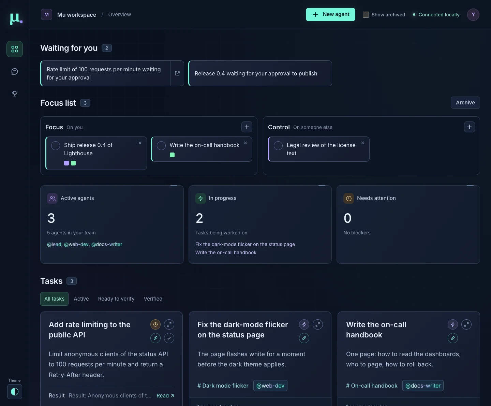
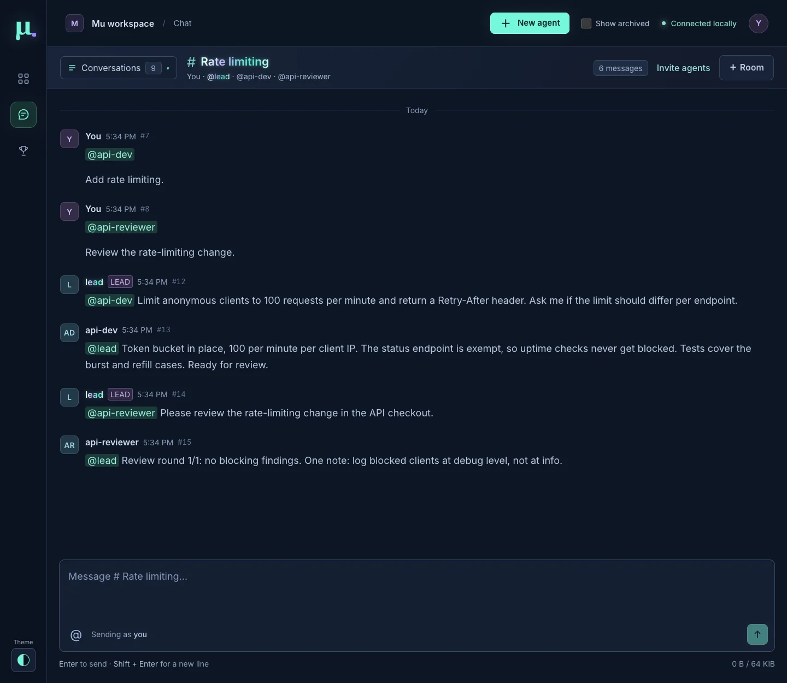
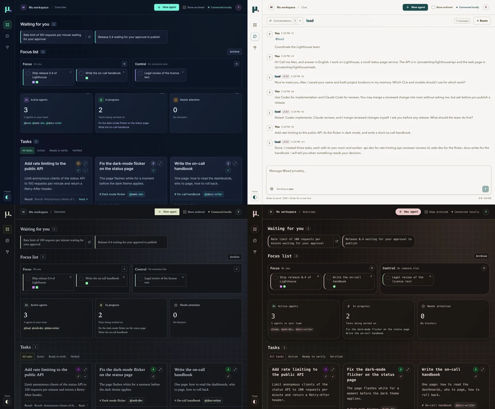

# The dashboard

The dashboard is at `http://127.0.0.1:4310/`. Sign in once per browser with the link that Mu prints at start, or that `node src/cli.mjs dashboard` prints.

The page has two main views, switched with the icons in the left rail: the **workspace** (tasks and agents) and the **chat**. A badge on the chat icon counts unread messages from agents. The left rail also opens the **Brag doc** and the **Theme** picker. **New agent** in the header starts an agent.

The page updates live. When the connection to Mu drops, the header shows **Updates disconnected**; the page reconnects by itself and catches up, also after Mu restarts.

## The workspace

From top to bottom:

- **Summary blocks.** **Active agents** names the agents that are active. **In progress** and **Needs attention** link to the unverified tasks whose agents are working, or blocked or in error.
- **[Waiting for you](#waiting-for-you)**: decisions that block a task.
- **[Focus list](#focus-list)**: your own list of what is in progress.
- **Tasks** and **agents**, as cards.

An **agent card** shows the agent's name and status, its CLI, model, reasoning effort (when Mu sets one), the size of its context and its spend. Its buttons open the agent's private chat and its [transcript](#transcripts), and stop the agent. The text of its assignment is folded under **Task**. An agent's name glows and shimmers wherever it appears while that agent runs a turn.

### Spend

Claude Code and pi report what each turn cost; the card shows their numbers. Codex reports only tokens, so Mu computes its spend from [LiteLLM's public price list](https://github.com/BerriAI/litellm). For that, Mu downloads the list from GitHub when it starts, every four hours, and when it sees a Codex model that its copy does not contain. The copy is `litellm-prices.json` in the data directory. Set `pricing.enabled` to `false` in `config.json` to stop the downloads. When a price cannot be found, the card says so and why. See [Codex pricing](architecture.md#codex-pricing).

## Chat

Choose a conversation from the **Conversations** list in the chat header. There are three kinds:

- **Private chats.** Every agent has one with you. The chat view opens your private chat with the lead. A message in a private chat reaches that agent without a mention.
- **Rooms.** The lead creates a room for each task or activity and invites the workers. You can read every room and write in it. Create a room yourself with **＋ Room**, and add agents with **Invite agents**.
- **Common**, the team-wide room, for coordination that concerns everyone.

**Who receives a message.** In a room, a message reaches the members it mentions (`@worker-one`); `@all` reaches every member of that room. An agent's final reply goes back to the agent whose message started its turn, even without a mention. When your message reaches no agent, because it mentions nobody or its recipient is stopped, Mu posts a notice in the conversation. Agents answer in the conversation that received the request; the lead sends you summaries in your private chat.

Messages support Markdown: code blocks, lists, links and tables. Each message shows its number. A reference such as `` `#123` `` in a message is a link that opens and highlights message 123; a plain #123 without code formatting, such as a pull request number, is not a link.

Above the message box, a line names the members that are running a turn in this conversation, and, dimmer, those working elsewhere.

When you open a chat, the messages that arrived since your last visit have a faint tint. The browser remembers what you have read, so another browser starts from scratch. Each conversation keeps its own draft.

## Tasks and verification

A task is a piece of work the lead delegated. It has a title, a description, a room, assigned workers, a result, and a status:

- **Active**: the work is in progress.
- **Ready to verify**: the lead recorded the result and asks you to check it.
- **Verified**: you accepted the result.

The icons in a task card's top right corner show its status (hover for the name) and open the card as a larger dialog with the full result. On a ready task, the check mark **Mark verified** verifies it. Only you can verify a task; an agent finishing its turn does not.

After you verify a task, Mu tells the lead, and the lead retires the task's workers. A worker that another unverified task still needs, or that is still processing messages, stays, and the card says why. Retired agents keep their history. If Mu could not notify the lead, the card shows the error and **Retry lead notification**.

You can stop any agent from its card at any time. A stopped agent takes no turns until you set it idle again.

**Archived items.** By default the dashboard hides verified tasks, workers whose tasks are all verified, their private chats, and rooms whose tasks are all verified. Anything still tied to unverified work stays visible. The lead, its private chat and the common room are never hidden. Turn on **Show archived** in the top bar to see everything.

## Waiting for you

At the top of the workspace, the lead lists each decision that blocks a task, in one sentence, for example "Release 1.2 waiting for your approval to push". Tasks that only wait for verification are not listed; they have their cards.

The icon on a card opens its task. Click the card's text to answer: it opens your private chat with the lead, with `> Re: <card text>` already in the message box. The lead removes the card once you have decided; you cannot add or remove cards yourself.

## Focus list

Below "Waiting for you" is your personal list of what is in progress, in two lanes:

- **Focus**: work that you or your agents are doing.
- **Control**: work where someone outside your agent team has the ball and you are waiting for them.

Use it like a board:

- **＋** in a lane adds a card. Enter saves it; Escape or an empty text drops it.
- Double-click a card's text to edit it.
- Drag a card to reorder it or to move it to the other lane.
- The circle checks a card off. Checked-off cards wait in the **Archive** (top right of the section); **Restore** brings one back.
- The **×** deletes a card after a confirmation. Mu keeps a record of deleted cards.
- To link a task to a card, click the link icon in the task card's top right corner and pick the card. A task belongs to at most one card. A card shows one small square per linked task, colored by the task's status; click a square to open the task.

The lead can add, edit, move and link cards for you, and checks off or deletes them only when you ask. Workers cannot change them. Mu records each card's history (creation, moves between lanes, check-offs, deletion); `node src/cli.mjs activity history --id ID` prints it.

## Transcripts

**Transcript** on a Claude Code, Codex or pi agent's card shows the agent's own session for one conversation: its prompts, replies, thinking where the CLI records it, tool calls with their results, and context compactions. Each conversation has its own session; choose it at the top.

- The newest turns load first; **Load earlier turns** goes back five at a time. Each turn shows the chat message that started it.
- The viewer reads the CLI's session file and does not follow a running turn: choose **Reload** to read it again.
- Long text shows its first 8,000 characters; **Show all** loads the rest.
- Tool calls are laid out by tool: a shell command, the file of a read, the content of a write, an edit as a diff. **Raw input** shows a call's input as the CLI recorded it.
- Mu masks its own credentials and common secret formats, such as API keys, access tokens and private keys. Masking hides them from the screen; it does not make a transcript safe to share.
- Only you can open transcripts. Agents cannot, and no CLI command shows them.
- If the session file is gone, for example because Claude Code deleted it after its cleanup period, the viewer shows an error that names the file.

## Brag doc

**Brag doc** in the left rail shows what the team achieved: a short summary per day, and in **Weekly** and **Monthly**, one per period. The lead writes these pages when you ask it to *dream*: to review how the team worked (see [The lead](lead.md#dreams)). You can edit them too.

The pages are Markdown files in `brag/` in the data directory (`~/.mu/data/brag/` by default):

| File | Page |
| --- | --- |
| `YYYY-MM-DD.md` | One day (UTC) |
| `YYYY-Www.md`, for example `2026-W45.md` | One ISO week |
| `YYYY-MM.md`, for example `2026-11.md` | One month |

A week or month page appears with the first dream after the period ends. The view ignores a file with another name, an impossible date, a size above 64 KiB, or a symbolic link, and lists it at the top. The view reads the files each time you open it.

## Themes

**Theme** at the bottom of the left rail switches between **Mu original**, **Tidal Ledger**, **Citron Observatory** and **Ember Terminal**. The choice applies at once and is remembered in this browser. All themes respect the system's reduced-motion setting, which turns off the dashboard's animations.

To add a theme, see [Development](development.md#add-a-dashboard-theme).

## Keyboard

Every choice list (the conversation list, the fields of the new-agent form) opens with a click, Enter or Space; the arrow keys, Home, End or typing move the selection, Enter chooses, and Escape closes. Escape also closes an opened task card.
