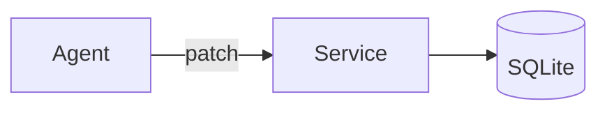

# Visuals

A visual is a document that an agent writes for you: a plan to approve, an explanation of a pull request, a design with diagrams. It has sections, highlighted code and Mermaid diagrams. The dashboard shows it beside its task, keeps every version, and redraws a section the moment the agent changes it.

Ask for one in plain words ("show me the plan as a visual", "explain this PR in a visual"). The lead tells the worker to write it; the agents learn the format from the visuals skill.

## Read a visual

Visuals appear in three places:

- **Visuals** in the left rail lists all of them, grouped by task, newest change first.
- A **task card** shows a chip for each visual of that task.
- In **chat**, an agent names a visual by its ID, such as `vis-1a2b3c4d`, and the dashboard shows it as a link with the visual's title.

The viewer shows the title, the author and the task above the document, and the list of sections on the left. Click a section to scroll to it; the section you are reading is marked. The document follows the theme and the text size of the [reading settings](dashboard.md#reading-settings).

## Versions

Each turn in which the agent changes a visual makes one new version. The header shows which version you are reading.

- While **Following** is shown, you see the newest version. When the agent changes a section, that section is redrawn in place and flashes; the rest of the page stays where it was.
- **‹** and **›** step through the versions. In the section list, `new` and `changed` mark what a version did; removed sections are named below the list.
- An older version stays on screen when a newer one arrives. The button **Newest: vN** returns to following.
- Every visual and every version has its own address, so the browser's Back button and bookmarks work.

## Links and images

A visual cannot load anything from the network. An image is shown only when the document carries it; a remote image is replaced by a note. A click on a link, in the text or in a diagram, does not navigate: the dashboard shows the address above the document and opens it in a new tab when you click **Open**.

A diagram or another block that cannot be drawn is replaced by the error and its source, and a notice above the document says in which section.

## How agents write visuals

An agent writes one Markdown file and sends it with the CLI. The first line `# Title` names the visual, each `## Heading {#id}` starts a section, a fenced block with a language is highlighted code, and a `mermaid` block is a diagram:

````markdown
# Move the session store to SQLite

What this is, and what you need from the reader.

## How it flows {#flow}


````

```bash
node src/cli.mjs visual create --file plan.md
node src/cli.mjs visual patch --id vis-1a2b3c4d --file changes.md    # only the changed and the new sections
node src/cli.mjs visual patch --id vis-1a2b3c4d --remove old-idea
node src/cli.mjs visual show --id vis-1a2b3c4d --section flow
node src/cli.mjs visual guide                                         # the visuals skill
```

Only the author changes a visual; you and the members of its conversation read it. A visual belongs to the conversation of the turn that created it and to that conversation's task. See the [CLI reference](cli.md#visuals) for every option, and `skills/visuals/SKILL.md` for the instructions the agents follow.

Limits: 200 sections per visual, 128 KiB per section, and 1 MiB for all sections of one version together. Code is highlighted in Bash, C, C++, CSS, diff, Dockerfile, Go, INI and TOML, Java, JavaScript, JSON, Kotlin, Markdown, Python, Ruby, Rust, shell sessions, SQL, Swift, TypeScript, XML and HTML, and YAML; other languages are shown as plain code.

## Where visuals are stored

In the database in the data directory (`~/.mu/data/mu.sqlite` by default), with every version. The service alone writes them.

## Safety

The content of a visual comes from an agent, which may have read untrusted text, so the dashboard treats it as hostile. It is drawn in a sandboxed frame that holds no credential and has no network access; the title, the author, the versions and the confirmation of a link are drawn by the dashboard itself, outside that frame. See [Security model](security.md#visuals) and [Architecture](architecture.md#visuals).
