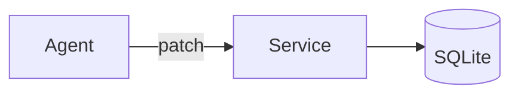

# Visuals

A visual is a document that an agent writes for you: a plan to approve, an explanation of a pull request, a design with diagrams. It has sections, highlighted code and Mermaid diagrams. The dashboard shows it beside its task, keeps every version, and redraws a section the moment the agent changes it. You comment on any part of it, and the agent that wrote it answers by changing that part.

Ask for one in plain words ("show me the plan as a visual", "explain this PR in a visual"). The lead tells the worker to write it; the agents learn the format from the visuals skill.

## Read a visual

Visuals appear in three places:

- **Visuals** in the left rail lists all of them, grouped by task, newest change first.
- A **task card** shows a chip for each visual of that task.
- In **chat**, an agent names a visual by its ID, such as `vis-1a2b3c4d`, and the dashboard shows it as a link with the visual's title.

The viewer shows the title, the author and the task above the document, and the list of sections on the left. Click a section to scroll to it; the section you are reading is marked. The document follows the theme and the text size of the [reading settings](dashboard.md#reading-settings).

## Versions

Each turn in which the agent changes a visual makes one new version. The header shows which version you are reading.

- While **Following** is shown, you see the newest version. When the agent changes a section, that section is redrawn in place and flashes; the rest of the page stays where it was.
- The arrow buttons on both sides of the version number step to the previous and the next version; hover over one, or reach it with Tab, to read its name. At the first and at the last version, the arrow that leads nowhere is faint, with a dashed edge. In the section list, `new` and `changed` mark what a version did; removed sections are named below the list.
- An older version stays on screen when a newer one arrives. The button **Newest: vN** returns to following.
- Every visual and every version has its own address, so the browser's Back button and bookmarks work.

## Comment on a visual

Tell the author what to change, at the place where you read it. The comments are on the right of the document.

- **Select text** and click **Comment** beside the selection. A selection can cover several paragraphs of one section, and works in code and in tables. **Click a diagram** to comment on it as a block.
- The buttons above the field say what the comment is about: the selected text or the block, the section you are reading, or the whole visual.
- Type what you want, or click a ready request: **Simpler**, **More detail**, **Example**, **Shorter**, **Why?**.
- **Send now** sends the comment to the author at once (also Ctrl or ⌘ + Enter). **Save draft** keeps it; only you see a draft, and you can edit, send or delete it. **Send all** sends every draft of the version in one message, so the author answers them in one turn.
- The text you commented on is marked in the document. Click a mark to see its comment, and a comment to see its place.
- While the author works on a comment, a soft light moves across what the comment is about: the selected text, the block, the section, or the whole visual. The comment shows **In work**. With several comments in one turn, each place is lit. The light goes out when the author's turn writes its version, where the changed sections flash, or when the turn ends without a change, also after an error or a restart of Mu. If your system asks for reduced motion, the place has a still tint and nothing moves.

A comment reaches the agent that wrote the visual as a chat message from you in the visual's conversation, so it continues the session in which the agent wrote the visual. The message names the section and quotes the text; you can read it in that conversation's chat. The agent changes the sections that the comments concern, which makes a new version, and each changed section flashes as it is redrawn. Write a name in a comment without `@`: a comment that mentions an agent is refused, because the message would start that agent too. A comment, the selected text or an answer that holds a character which is not shown, such as a zero-width space pasted from another page, is refused with the character named, so the author gets only what you saw.

Comments stay with the version they were written on. A new version starts without comments and lists, under **Answered in this version**, the comments that it answers. An earlier version keeps its comments; each shows **Answered in version N** once the author answered it. The list of visuals shows for each visual how many drafts wait for you and how many sent comments wait for the author.

When the author changes a section in the same turn after you commented on it, the comment keeps the text it was written on and says that the section changed. A stopped author reads its comments when it is resumed.

## Answer questions

A visual can ask you questions: one of several options, several of them, a short text, a number, or yes or no. The controls are in the document, at the place where the question comes up, and your answers are listed on the right under **Your answers**.

- Click or type your answer. It is stored at once and stays yours: the author does not see it until you send it. Each question shows where it stands: no answer, the author's suggestion, not sent, or sent.
- The author can suggest an answer. A suggestion that you leave as it is counts as your answer when you send.
- **Send answers** sends all answers of the visual in one message, together with your draft comments on that version, so the author gets one round of feedback in one turn. While answers wait, a line over the document says how many, and **Review and send** takes you to the list.
- After sending you can change an answer and send again; the message then says which answers changed. **Clear** takes an answer back, and **Back to the suggestion** returns to what the author suggested.
- You send what the list shows, so read it before you send. When a line of the list changed just before your click, nothing is sent: the line is marked **Changed just now**, and you click **Send answers** again after reading it.

Questions are answered on the newest version. An earlier version shows its questions with your answers and takes no change. An answer stays with its question: when the author changes other parts of the visual, or moves the question, your answer is still there; when the author changes the question itself, its help or the hint of an option included, it starts without an answer, and so does a question whose suggestion you kept when the author takes the suggestion away. The list of visuals shows for each visual how many questions wait for you.

## Links and images

A visual cannot load anything from the network. An image is shown only when the document carries it; a remote image is replaced by a note. A click on a link, in the text or in a diagram, does not navigate: the dashboard shows the address above the document and opens it in a new tab when you click **Open**.

A diagram or another block that cannot be drawn is replaced by the error and its source, and a notice above the document says in which section.

## How agents write visuals

An agent writes one Markdown file and sends it with the CLI. The first line `# Title` names the visual, each `## Heading {#id}` starts a section, a fenced block with a language is highlighted code, a `mermaid` block is a diagram, and a `form` block asks questions:

````markdown
# Move the session store to SQLite

What this is, and what you need from the reader.

## How it flows {#flow}



## Decide {#decide}

```form
{ "fields": [
  { "id": "store", "type": "choice", "label": "Which store?", "default": "sqlite",
    "options": [ { "id": "sqlite", "label": "SQLite", "hint": "One file" }, { "id": "files", "label": "Keep the files" } ] },
  { "id": "dry-run", "type": "toggle", "label": "Start with a dry run?" }
] }
```
````

```bash
node src/cli.mjs visual create --file plan.md
node src/cli.mjs visual patch --id vis-1a2b3c4d --file changes.md    # only the changed and the new sections
node src/cli.mjs visual patch --id vis-1a2b3c4d --remove old-idea
node src/cli.mjs visual show --id vis-1a2b3c4d --section flow
node src/cli.mjs visual comments --id vis-1a2b3c4d                   # your comments that wait for an answer
node src/cli.mjs visual patch --id vis-1a2b3c4d --file changes.md --resolves vc-5e6f7a8b
node src/cli.mjs visual answers --id vis-1a2b3c4d                    # the answers you sent, by question
node src/cli.mjs visual guide                                         # the visuals skill
```

Only the author changes a visual; you and the members of its conversation read it, and only you comment on it and answer its questions. A visual belongs to the conversation of the turn that created it and to that conversation's task. See the [CLI reference](cli.md#visuals) for every option, and `skills/visuals/SKILL.md` for the instructions the agents follow.

Limits: 200 sections per visual, 128 KiB per section, and 1 MiB for all sections of one version together; 200 comments per version, each up to 4000 bytes, with a quote of up to 600 characters; 30 questions per form with up to 12 options each, 100 questions per version, and 2000 characters per text answer. Code is highlighted in Bash, C, C++, CSS, diff, Dockerfile, Go, INI and TOML, Java, JavaScript, JSON, Kotlin, Markdown, Python, Ruby, Rust, shell sessions, SQL, Swift, TypeScript, XML and HTML, and YAML; other languages are shown as plain code.

## Where visuals are stored

In the database in the data directory (`~/.mu/data/mu.sqlite` by default), with every version, every comment and every answer. The service alone writes them.

## Safety

The content of a visual comes from an agent, which may have read untrusted text, so the dashboard treats it as hostile. It is drawn in a sandboxed frame that holds no credential and has no network access; the title, the author, the versions, the comments, the list of your answers and the confirmation of a link are drawn by the dashboard itself, outside that frame. The controls of a question are inside the frame, so nothing is sent from there: you send from the list, which shows what the service stored. See [Security model](security.md#visuals) and [Architecture](architecture.md#visuals).
