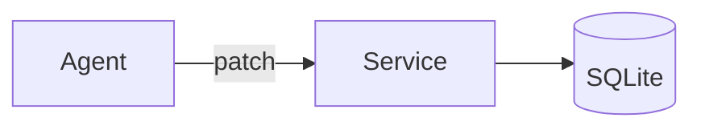

# Visuals

A visual is a document you write for the user. The dashboard shows it beside the task, draws its diagrams, highlights its code, keeps every version, and updates in place while you change it. Chat stays the place for coordination; a visual is the place for the thing itself.

Write a visual when the user must read, compare or decide: a plan before the work, an explanation of a pull request, a design with a diagram, a report with structure. Do not write one for a short answer, a status update or anything that fits in a few lines of chat.

## Write one

A visual is one Markdown file. Write it to a file, then send it:

```bash
node "$MU_CLI" visual create --file .tmp/plan.md
```

````markdown
# Move the session store to SQLite

One or two sentences that say what this is and what you need from the reader.

## Why {#why}

Text, lists, tables, links and `code`.

## How it flows {#flow}



## Steps {#steps}

```js
export const rev = (section) => hash(section).slice(0, 16);
```
````

- The first line `# Title` names the visual. Text before the first `##` is the lead section, `intro`.
- Each `## Heading {#id}` starts a section. Give every section an ID (lowercase letters, digits, hyphens): the ID is how you change that section later, and it survives a new heading. Without `{#id}` the ID is derived from the heading.
- A fenced block with a language is highlighted code. A `mermaid` block is drawn as a diagram. Inside a section use `###` and deeper headings.
- An image must be a `data:` URL of a PNG, JPEG, GIF or WebP; the dashboard loads nothing from the network. Raw HTML is removed. A link opens only after the user confirms its address.
- The reply names the visual (`vis-…`) and its sections. Mention the visual to the user by its ID as a code span, `` `vis-1a2b3c4d` ``: the dashboard turns it into a link.

The visual belongs to the conversation of your turn and to its task. Only you, its author, can change it.

## Revise it

Change sections; do not send the whole document again. Put only the changed and the new sections into a file:

```bash
node "$MU_CLI" visual patch --id vis-1a2b3c4d --file .tmp/changes.md
```

- A section whose ID exists is replaced. A section with a new ID is added after the section before it in the file, or at the end; `--after ID`, `--before ID` or `--first` place it elsewhere.
- Start the file with the `## Heading {#id}` of the first section you change. Text before the first `##` replaces the lead section `intro`, and a first line `# Title` renames the visual.
- `--remove ID[,ID]` removes sections. `--move ID` with `--after`, `--before` or `--first` moves one. `--title TEXT` renames the visual.
- `--replace` makes the file the whole document: a section that is not in the file is removed. Only the sections that differ from the stored ones are marked as changed. Use it for a restructuring; for a change to a few sections, send those sections.
- All changes of one turn make one new version. The user sees the changed sections flash and can step back to every earlier version, so say in chat what changed only when it is not obvious from the visual.

Read back what is stored before you change it, so that you patch the current text and not what you remember:

```bash
node "$MU_CLI" visual show --id vis-1a2b3c4d                  # outline: sections, sizes, block types
node "$MU_CLI" visual show --id vis-1a2b3c4d --section steps  # the Markdown of one section
node "$MU_CLI" visual list --conversation ID                  # the visuals of one conversation; without it, every visual you can read
```

## Make it worth reading

- Lead with the conclusion or the decision you need. One idea per section, with a heading that says it.
- Prefer a diagram for structure, flow and sequence; a table for a comparison; code only where the exact text matters.
- Keep a diagram small enough to read: split a large one by concern. A diagram that Mermaid cannot parse is shown as an error in its place, so keep the syntax simple and check the reply of the command.
- Write for a reader without your context: full sentences, defined terms, no internal labels.
